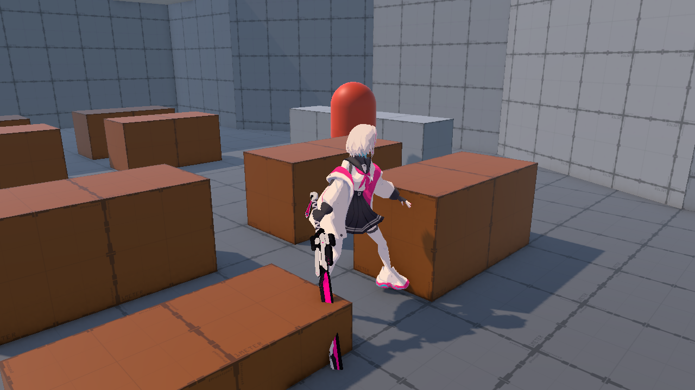
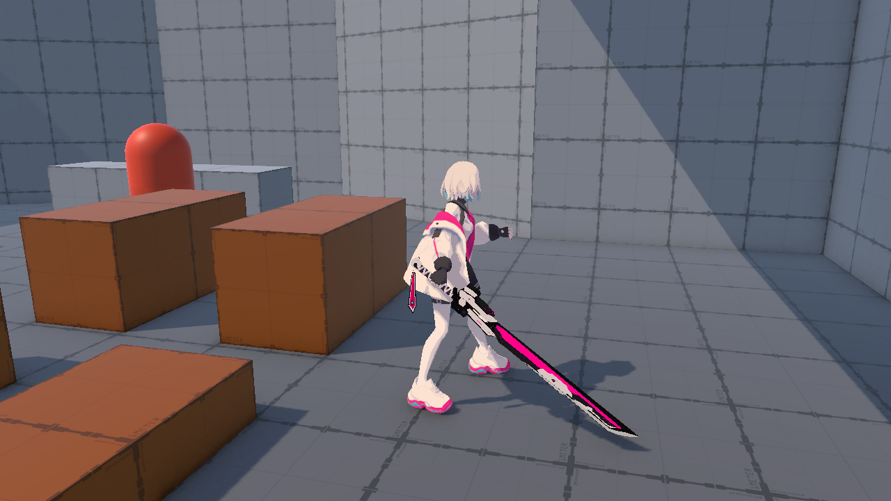
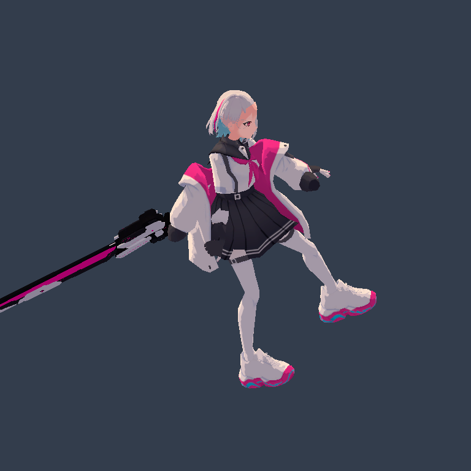

# Fuchsia 이동 애니메이션

적용 씬: `Assets/CK_Semester_Project/Prototype/Scenes/TutorialGrayboxingDemo.unity`

## 연결 구조와 조작

- `Fuchsia Player`: 기존 CharacterController, PlayerMovement, 층 이동 및 카메라 연결.
- 자식 `Fuchsia Visual`: `FuchsiaAnimated.prefab`의 인스턴스. 리깅된 모델, Animator, 검을 포함한다.
- Game 뷰를 클릭해 마우스를 잠근 뒤 WASD로 걷고 Shift를 누른 채 이동하면 달린다. 기존 달리기 토글도 사용 가능하다.
- 입력이 없거나 이동 기능이 비활성화되면 Idle로 돌아간다.

## 에셋

기본 경로: `Assets/CK_Semester_Project/Prototype/Sandbox/Junmo/FuchsiaShading/`

- `Prefabs/FuchsiaAnimated.prefab`: `Assets/Ani_perpef(test)/Idle/idle.fbx`에서 만든 프리팹 Variant. 유효한 Generic `idleAvatar`와 7개 SkinnedMeshRenderer를 사용한다.
- `Animations/FuchsiaLocomotion.controller`: 이동 FSM용 상태 3개(`Idle` / `Walk` / `Run`). 전이와 파라미터 없이 코드가 상태마다 CrossFade로 넘긴다(2026-10-29, 아래 "이동 FSM" 참고).
- 모션: Walk·Run은 `Assets/Ani_perpef(test)`의 `walking.fbx`, `running.fbx` 클립(Take 001)을 그대로 쓴다. Idle은 `idle.fbx`의 Bip001이 41cm 옆·7cm 아래에 있어, 그 오프셋만 뺀 같은 모션 `Animations/FuchsiaIdle.anim`을 쓴다(나머지 본은 원본과 차이 0).
- `Animations/FuchsiaWalk.anim`, `FuchsiaRun.anim`: 이전 Blend Tree용 복사본. 원본 FBX와 같아 Controller에서는 더 이상 쓰지 않는다.
- 기존 얼굴·머리·의상 툰 머티리얼과 투명 안경알을 재사용한다. 검은 `Materials/FuchsiaKatanaToon.mat`에서 제공된 Katana_BaseColor 텍스처를 사용한다.

PlayerMovement의 Animator 필드는 새 자식 Animator를 참조한다. Controller에 Idle / Walk / Run 상태가 있으면 상태마다 자기 모션을 재생하고, 없으면(다른 씬의 UnityChan 등) 기존 Speed/Direction 파라미터 방식을 쓴다. 기본 걷기는 3m/s, 달리기는 5.4m/s이며 Root Motion은 꺼져 있다.

모델 스케일은 기존의 1.07563651을 유지하고 새 리그의 원점과 CharacterController 접촉 여유에 맞게 로컬 위치를 `(0, -0.025, 0)`으로 조정했다. 렌더러의 컬링 범위는 세 모션과 Blend Tree의 중간 자세를 샘플링해 각 rootBone 공간에서 계산했다.

기존 정적 `FuchsiaToon.prefab`과 모션 FBX의 임포트 설정은 유지했다. 다른 씬의 Fuchsia는 이번 작업으로 교체하지 않았다.

## 검증 — 2026-10-14

- Unity 스크립트 재컴파일 성공.
- 임시 프리뷰에서 실제 Animator Controller를 평가했을 때 Speed 0/0.5/1에 각각 Idle/Walk/Run이 연결되고 본이 움직임.
- Play 모드에서 기존 Move 메서드를 입력 벡터·달리기 플래그로 호출하는 프로브로 정지 → 걷기 → 달리기 → 정지를 검증. 실제 속도 0 / 3.0 / 5.4 / 0m/s 및 접지 유지 확인.
- 이동 컴포넌트를 비활성화하면 Speed가 0으로 초기화됨.
- 세 모션과 Speed 0 / 0.25 / 0.5 / 0.75 / 1의 중간 자세를 검사했으며, 실제 씬의 회전·스케일을 적용한 Play 모드에서도 컬링 범위 밖 정점 0개.
- 게임 카메라로 모델·툰 재질·검·그림자 확인. 프로브 수행 중 새로운 런타임 오류 없음.
- 프로브는 실제 사용자 키보드 조작을 대신하지 않는다. 기존 UnityChan SpringBone/SpringManager 중복 타입 컴파일 경고는 별도 문제다.

## 발과 그림자 접점 보정

초기 Visual 높이 +0.02m에서 확인한 Idle 포즈의 밑창 높이는 46.99622m, 바닥 메시 표면은 46.95271m로 약 4.35cm 간격이 있었다. CharacterController의 Skin Width 0.03m에 의한 접촉 여유와 모델 높이 보정이 합쳐져, 멀리서는 발이 붙어 보이면서도 그림자는 분리되어 보였다.

같은 포즈에서 광원의 Depth/Normal Bias를 낮추거나 0으로 바꾸어도 간격이 남는 것을 확인했다. 광원은 원래 설정(URP 파이프라인 설정 사용)으로 복원하고 Visual 로컬 Y만 -0.025m로 수정했다. 해당 포즈의 밑창과 바닥 차이는 약 -0.00148m로 줄었다. 이 보정은 모델 전체의 기준 높이를 조정하며 지형 대응용 발 IK는 추가하지 않는다.

## 2026-10-15 새 FBX 적용 — 기존 리깅 유지

브랜치 `feat/tutorial-demo-grayboxing`을 원격 `9b542b0`까지 갱신한 뒤 제공된 `character_fuchsia_01 (1).fbx`를 기존 `Models/character_fuchsia_01.fbx`에 적용했다. 원본 FBX의 GUID는 유지한다.

전체 정적 외형에 가중치를 새로 계산하던 이전 방식은 제거했다. 현재 `FuchsiaUpdatedAnimated.prefab`은 수정 전 `FuchsiaAnimated.prefab`의 기존 **7개 SkinnedMeshRenderer, 본, 본 가중치, bindpose, 삼각형, 머티리얼, Avatar와 Animator Controller**를 유지한다. 머리·머리카락·안경·외투·치마·검은 기존 메시 그대로 사용한다.

새 FBX와 교체 전 FBX를 비교하면 실질적인 메시 변경은 `몸` 부품에 한정된다. 기존 리깅 body 메시 안에서 동일 UV와 위치로 대응되는 883개 정점에 새 FBX의 외형 데이터를 적용하고, 나머지 정점과 리깅 데이터는 그대로 둔다. 교체된 스킨 메시 하나만 `Models/FuchsiaUpdatedBody.asset`에 저장한다. 벨트의 내보내기 변환 차이는 외형 위치를 바꿀 수준의 변경이 아니므로 기존 리깅 위치를 유지한다.

튜토리얼 씬의 `Fuchsia Visual`은 새 프리팹을 참조한다. 이동·전투 코드 및 모션 클립은 변경하지 않았다. 이전에 생성했던 35개 재스키닝 부품 메시와 비교용 임시 FBX는 제거했다.

검증:

- 원본 대비 7개 렌더러의 본 가중치·bindpose·삼각형·머티리얼 일치.
- Idle/Walk/Run 각각 5개 시점, 총 15개 포즈에서 전체 정점의 원본 대비 최대 위치 차이 `0.000000648m`.
- 기존 리그와 동일한 모션으로 재생되는 정면·측면 렌더 확인.
- 전체 튜토리얼/전투 완주와 UI 화면 비율 검사는 이번 모델 교체 범위에서 실행하지 않았다.

아래는 교체 후 기존 Run 모션을 적용한 렌더다. 원본 모션의 손·소매 간격 등은 새 웨이트를 계산해 변경하지 않는다.

## 전투 대기 모션

전투 진입 시 TutorialBattleController는 실제 자식 Fuchsia 모델의 활성 Animator를 찾는다. 이동을 비활성화하면 PlayerMovement가 Idle 상태로 돌아가 FuchsiaIdle을 재생한다(파라미터 방식 Controller는 Speed 0). Animator를 정지시키지 않으므로 대기 모션은 계속 반복된다. 전투 종료/취소 시 이전 Animator 재생 속도를 복원하고, 이동이 다시 켜지면 FSM이 입력에 맞춰 Walk/Run 상태로 넘어간다.

## 2026-10-29 이동 FSM(상태 패턴)

`Assets/CK_Semester_Project/Prototype/Scripts/Tutorial/`

- `PlayerMovement`: FSM의 주인. 매 프레임 입력을 `PlayerMovementInput`으로 모으고, 현재 상태의 `GetNextState`로 다음 상태를 고른 뒤(바뀌면 이전 상태 `Exit` → 새 상태 `Enter`) `Tick`으로 이동시킨다.
- `PlayerMovementState`: 상태 하나의 기반 클래스. `Enter` / `Exit` / `GetNextState` / `Tick`과 Animator 상태 이름(기본은 상태 이름과 같음)을 가진다. 기본 `Enter`는 같은 이름의 Animator 상태로 0.15초 CrossFade한다.
- `PlayerGroundedState`: 땅 위 상태 공통 전이. 입력 없음 → Idle, 이동 → Walk, 이동 + Shift(또는 HUD 달리기 토글) → Run. Shift만 눌러서는 달리지 않는다.
- `PlayerMoveState`: 걷기·달리기 공통. 정해진 속도로 이동하고, 벽에 막혀 실제로 거의 움직이지 못하면 상태는 그대로 둔 채 Idle 모션을 보여 준다(제자리 걸음 방지).
- `PlayerIdleState` / `PlayerWalkState` / `PlayerRunState`: 상태별 이름과 이동 속도만 정한다.

### 새 상태 추가(예: 점프)

1. `PlayerMovementInput`에 점프 입력을 추가하고 `PlayerMovement.Update`에서 Space를 읽어 채운다.
2. `PlayerJumpState : PlayerMovementState`를 만든다. `Enter`에서 위로 속도를 주고, `Tick`에서 공중 이동을, `GetNextState`에서 착지하면 땅 위 상태로 돌아가는 전이를 정한다(수직 속도·접지 상태를 다룰 메서드는 PlayerMovement에 추가).
3. `PlayerMovement`에 `JumpState` 인스턴스를 두고, `PlayerGroundedState.GetNextState` 맨 앞에 점프 전이를 넣는다.
4. 모션이 생기면 Controller에 `Jump` 상태를 추가하고 클립을 연결한다. Controller에 그 상태가 없는 동안에는 이전 모션을 유지하고 경고를 한 번만 남긴다.

검증: PlayMode 테스트 `PlayerLocomotionStateTests` 3개와 새 `PlayerAnimationStateTests` 3개 통과(실제 프리팹·Controller로 상태별 모션, 벽에 막힘, 이동 비활성화 시 Idle, 각 모션에서 몸이 충돌체 위에 남는지 확인). `TutorialBattleCameraSettingsTests`·`PrototypeHudIntegrationTests`는 `65e9470` 이후 씬의 전투 컨트롤러 `_enemies`가 10개라 SetUp에서 멈춘다(이번 변경 전부터, 미수정).
