# 푸시아 복도 라이팅 테스트

## 현재 구성

- 브랜치: `feat/shader-development`
- 씬: `Assets/CK_Semester_Project/Prototype/Scenes/FuchsiaShadowTest.unity`
- 자산: `Assets/CK_Semester_Project/Prototype/Sandbox/Junmo/FuchsiaShading/`
- 모델: 2026-10-18 제공된 새 FBX를 기존 경로에 교체. 기존 35개 부위와 14개 머티리얼 연결 유지.
- 배경: 폭 약 6m, 길이 24m의 복도 블록아웃. 벽·바닥·프레임·파이프·출입문·조명기구는 일반 `Universal Render Pipeline/Lit` 재질이다.
- 푸시아: 부위별 Toon 셰이더 유지. 조명 계산은 `FuchsiaLighting.hlsl`, 툰 명암은 `FuchsiaToonCommon.hlsl`에서 관리한다.

## 그림자 한 단계

밝은 면 + 그림자 한 단계로 변경했다. 주광원과 추가 광원의 직접광을 합한 밝기에 대해 `Light / shade boundary` 경계를 한 번만 적용한다. 각 광원마다 별도 툰 경계를 만들지 않는다.

`Single shadow tint`는 단일 그림자 색, `Boundary softness`는 경계 완화, `Toon shading strength`는 그림자 색 적용 강도다. 기존 `_DeepShadeColor`, `_DeepShadeStep` 저장 필드는 호환성을 위해 남겼지만 Inspector에서 숨겼으며 현재 명암 계산에 사용하지 않는다.

광원의 거리 감쇠, 원본 텍스처의 명암, 머리·장신구 광택은 유지하므로 모든 픽셀이 두 가지 RGB 색으로만 출력되는 것은 아니다. 원본 텍스처의 고정된 명암은 조명과 함께 회전하지 않는다.

## 앰비언트 및 추가 광원

- `SampleSH(normalWS)`로 면의 방향에 따른 환경광/기존 SH 라이트 프로브 조명을 샘플링한다.
- 주변광을 직접광의 그림자 계수에 곱하지 않아 그늘에서도 주변 색과 밝기가 남는다.
- `Environment and probe fill`은 해당 머티리얼의 주변광 강도다. 기본값 1.
- 현재 씬은 Trilight 환경광을 사용한다. 하늘 (0.58, 0.64, 0.75), 수평 (0.42, 0.47, 0.56), 지면 (0.26, 0.30, 0.38)이다.
- Point/Spot 광원의 색, 방향, 거리 감쇠, 지원되는 실시간 그림자를 계산한다. Forward 및 클러스터 광원 루프 경로를 구현했고 현재 프로젝트 렌더러에서 렌더를 확인했다.
- 머리·장신구·렌즈의 광택은 해당 픽셀에 기여하는 주요 광원 방향을 사용한다.

이 씬은 환경광과 실시간 광원 반응을 검증하는 구성이다. 벽에서 반사된 확산 간접광을 베이크하거나 APV를 구축하지는 않았다. 배경 반사는 별도의 베이크된 Reflection Probe를 사용하며 캐릭터의 SH 환경광과 다른 기능이다. 발광 재질 자체의 빛 번짐이나 간접조명은 베이크하지 않았으며 실제 조명은 아래 Light 컴포넌트가 담당한다.

## 조명과 카메라 조절

| 대상 | 용도 |
|---|---|
| `CorridorTest/Geometry_PBR` | 일반 PBR 배경 블록아웃 |
| `CorridorTest/AdditionalLights_ToggleForComparison` | 추가 광원 8개. 그룹 활성화를 끄면 추가 광원 전후 비교 가능 |
| `CeilingSpot_0` ~ `CeilingSpot_5` | 흰색 천장 Spot Light 6개. 앞쪽 3개만 그림자 사용 |
| `CoolFill_Left` | 청색 보조 Point Light |
| `WarmFill_Right` | 따뜻한 보조 Point Light |
| `KeyLight_AdjustRotation` | 주광원. 강도 0.6, 회전 (55, -145, 0) |
| `CorridorReflectionProbe` | 배경 반사용 박스 프로브. 배경·조명 수정 시 다시 베이크 필요 |
| `Main Camera` | 기본으로 활성화된 후방 플레이 시점 |
| `FrontComparisonCamera` | 전신 정면 비교. 기본 비활성화 |
| `FaceDetailCamera` | 얼굴 확대 비교. 기본 비활성화 |
| `ShadowReceiver` | 기존 회색 평면, 비활성화하여 보관 |

환경광은 Lighting 창의 Environment 설정에서 변경한다. 캐릭터 주변광 비교는 부위별 머티리얼의 `Environment and probe fill`을 0/1로 바꾸면 된다. 카메라를 전환할 때는 Main Camera를 끄고 원하는 비교 카메라를 켠다.

## 부위별 머티리얼

| 부위 | 머티리얼 | 셰이더 |
|---|---|---|
| 겉머리·앞머리·옆머리·뒷머리 | FuchsiaHairToon | Hair Toon |
| 얼굴·눈썹·속눈썹·입 | FuchsiaFaceToon | Face Toon |
| 눈동자·눈 하이라이트 | FuchsiaEyesToon | Face Toon |
| 손 | FuchsiaHandsToon | Face Toon |
| 몸·벨트끈 | FuchsiaOutfit01Toon | Cloth Toon |
| 외투 | FuchsiaCoatToon | Cloth Toon |
| 치마 | FuchsiaSkirtToon | Cloth Toon |
| 다리 | FuchsiaOutfit02Toon | Cloth Toon |
| 리본 | FuchsiaRibbonToon | Cloth Toon |
| 신발·끈 | FuchsiaShoesToon | Cloth Toon |
| 안경테 | FuchsiaGlassesFrameToon | Accessory Toon |
| 머리핀 | FuchsiaHairpinToon | Accessory Toon |
| 단추 | FuchsiaButtonsToon | Accessory Toon |
| 안경알 | FuchsiaGlassesLens | Lens Toon |

옷·머리·장신구의 그림자 수신 강도는 1이며, 눈은 0.25다. 렌즈는 투명 재질로 깊이 쓰기와 그림자 투사가 꺼져 있다. 의상 알파 TGA는 보관하지만 불투명 옷 재질에는 연결하지 않았다.

## 검증

- 부위별 셰이더 5종 오류·컴파일 메시지 없음.
- 모든 복도 렌더러가 URP/Lit을 사용하는지 확인.
- 같은 정면 카메라에서 주변광 0/1 및 추가 광원 Off/On 비교 렌더를 확인한 후 기본값 복원.
- 주변광을 끄면 그늘진 푸시아가 어두워지고, 추가 광원을 끄면 좌우 조명의 색과 직접광이 사라지는 것을 확인.
- 초기 추가 광원 그림자 아틀라스 경고를 확인한 뒤 Point Light 그림자를 끄고 천장 그림자 해상도 티어를 조정했다. 최종 Play 모드 확인 후 Console 오류·경고 없음.
- Play 모드 렌더 확인 및 종료. 씬은 저장된 편집 상태로 열어 두었다. 이동·애니메이션 기능은 추가하지 않았다.

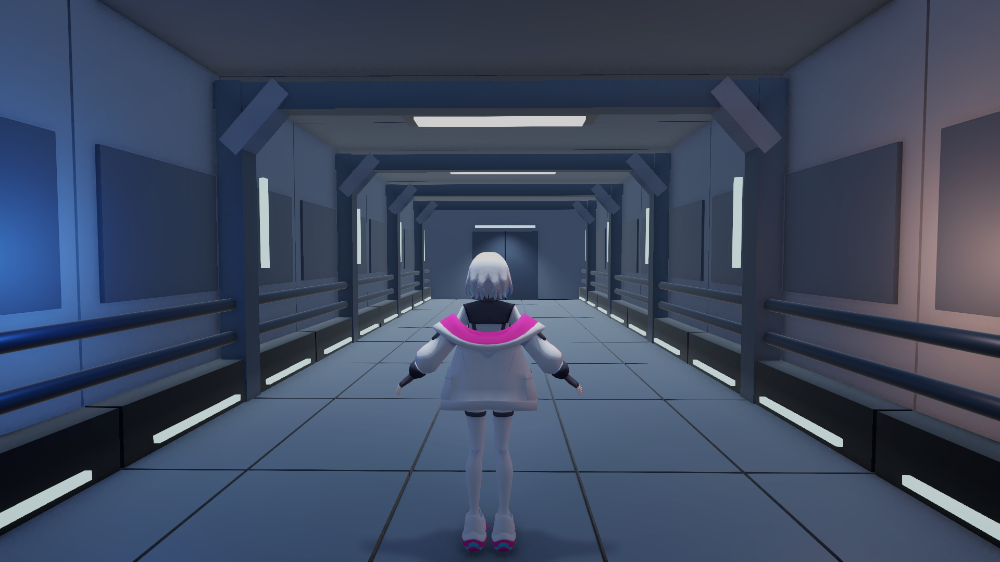

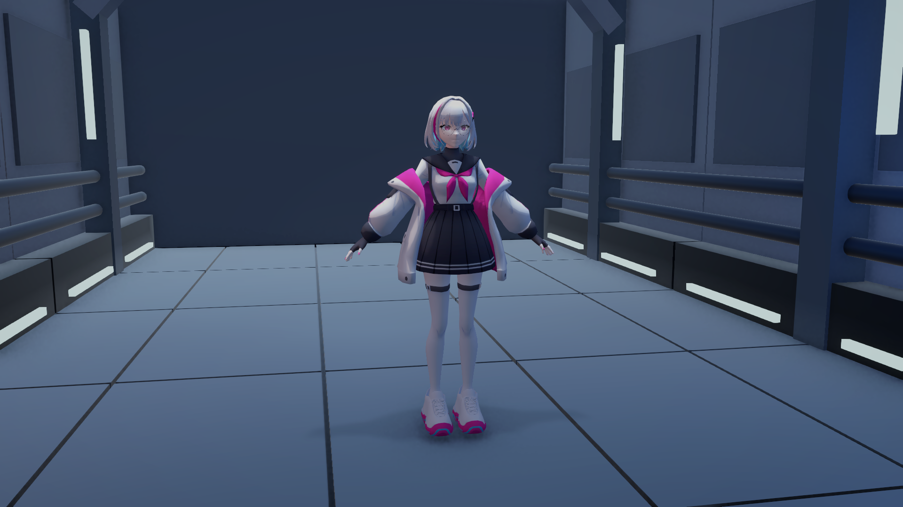

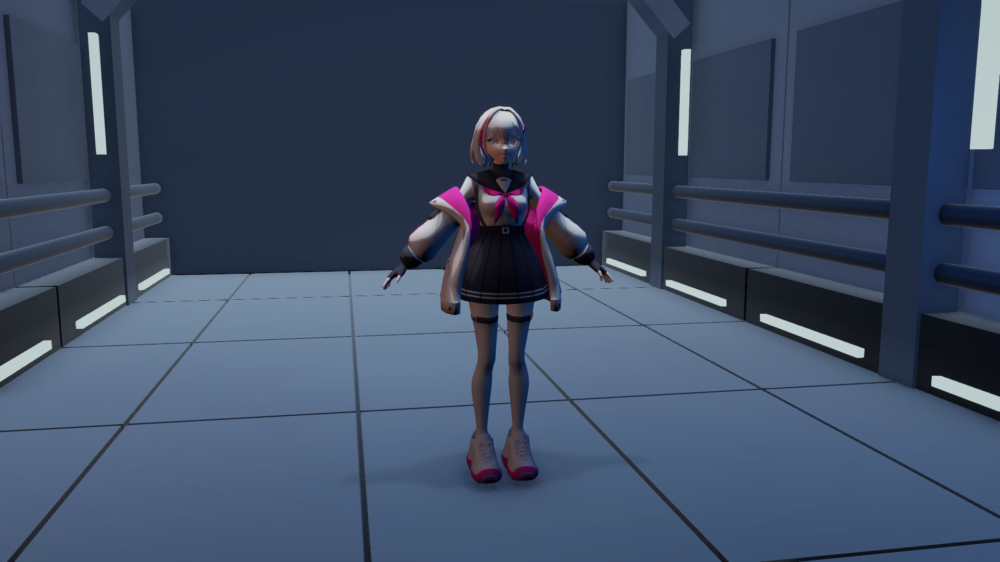

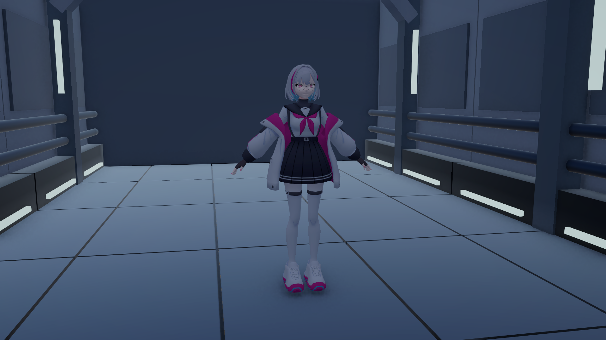

## 배경 재질별 PBR 쉐이딩

모든 배경은 일반 `Universal Render Pipeline/Lit`을 사용한다. 재질별 Base Color·금속도·Smoothness·Normal·Occlusion 맵으로 도장·금속·고무를 구분했다. 배경용 툰 셰이더는 사용하지 않는다.

| 머티리얼 | 표면 구성 | 금속도 맵 R | Smoothness 맵 A의 기준 |
|---|---|---|---|
| WallPaint | 밝은 무광 도장, 미세 입자, 패널 이음새, 작은 모서리 손상 | 도장 0, 작은 노출부 약 0.85 | 약 0.30 |
| FloorMetal | 금속 바닥, 판 이음새, 고정점, 얕은 결, 마찰 자국 | 약 0.94 | 일반 면 약 0.80, 마찰 자국은 더 거칠게 |
| PanelTrim | 노출 금속 프레임의 미세한 방향성 결 | 약 0.96 | 약 0.58 |
| DarkSteel | 어두운 구조용 금속·조명 하우징 | 약 0.92 | 약 0.43 |
| PipeBlue | 청색 도장, 매끄러운 도장 광택, 작은 도장 손상 | 도장 0, 작은 노출부 약 0.90 | 약 0.56 |
| DoorPaint | 도장 출입문·벽 인셋, 가로 프레스 홈 | 0 | 약 0.38 |
| RubberGasket | 하단 보호대·바닥 기초·문틈, 거친 검은 고무 | 0 | 약 0.14 |
| CeilingCoating | 천장 무광 도장, 벽 표면 맵을 공유 | 대부분 0 | 벽 맵 × 0.75 |
| WhiteLamp | 미세 확산 패턴의 불투명 발광 커버 | 0 | 약 0.20~0.28 |
| BlueLamp | 청색 발광 커버 | 0 | 약 0.20~0.28 |

`Materials/Corridor/`에서 해당 재질을 선택한다. Smoothness 슬라이더는 맵에 저장된 매끄러움에 곱하는 전체 배율이며, 실제 금속도는 Metallic 맵의 R 채널에 들어 있다. 고무와 도장면은 Metallic 슬라이더가 1이어도 맵의 값이 0이므로 금속으로 처리되지 않는다.

### 표면 맵과 재생성

- 경로: `Textures/Corridor/`. 표면 8종 × Base/Mask/Normal = PNG 24개, 각 512×512.
- Base는 sRGB, Mask는 Linear로 임포트한다. Mask는 R=금속도, G=국소 Occlusion, A=Smoothness다.
- Normal은 Unity Normal Map 타입으로 임포트한다. 모든 맵은 mipmap·반복 샘플링을 사용한다.
- 절차적 생성 원본: `Docs/Tools/GenerateCorridorSurfaceMaps.py`. Unity 프로젝트 루트에서 Python + NumPy + Pillow로 재생성할 수 있다. 기존 .meta를 유지하면 재질 연결도 유지된다.
- 표면 패턴은 고정된 시드로 생성하며, 방향성 그림자나 조명은 Base 맵에 그려 넣지 않았다. 홈의 국소 Occlusion만 포함한다.
- 프레임의 결은 Normal/Smoothness 변화로 표현한 것이며, URP/Lit에 별도의 이방성 BRDF를 추가한 것은 아니다.
- 조명 커버는 확산 패턴이 있는 불투명 발광 표면이다. 투명 유리나 굴절 셰이더는 아니다.
- `MaterialDetailCamera`를 추가했다. 기본 비활성화 상태이며 파이프·벽·프레임·바닥의 가까운 비교용이다.
- 배경·조명 수정 후 Reflection Probe를 다시 베이크해야 한다. 현재 반사는 정적인 프로브 방식이며 움직이는 캐릭터를 실시간으로 반사하지 않는다.

### 재질 작업 검증

같은 광원·카메라에서 전체 전후 화면 및 근접 화면을 확인했다. 재질 10종에 맵 누락 없음, Mask의 Linear 설정과 Normal 임포트 타입 확인, 배경 셰이더 오류 없음, Play 모드 Console 오류·경고 없음. 재질 변경 후 Reflection Probe를 다시 베이크했다.

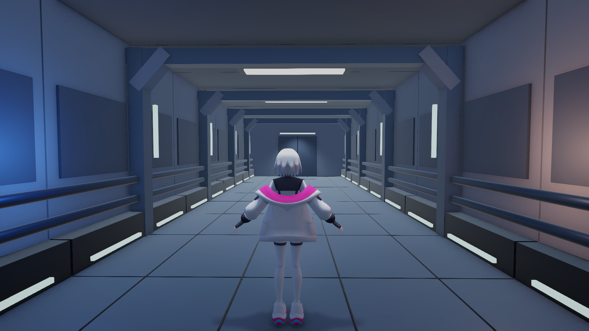

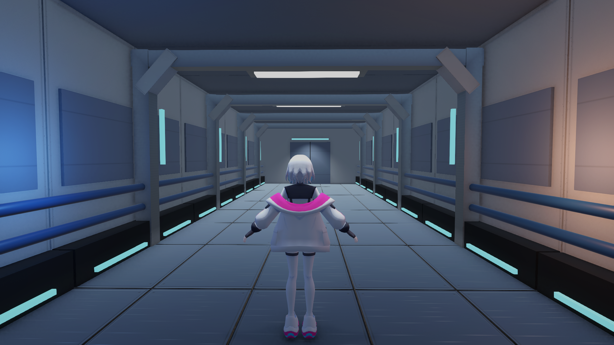

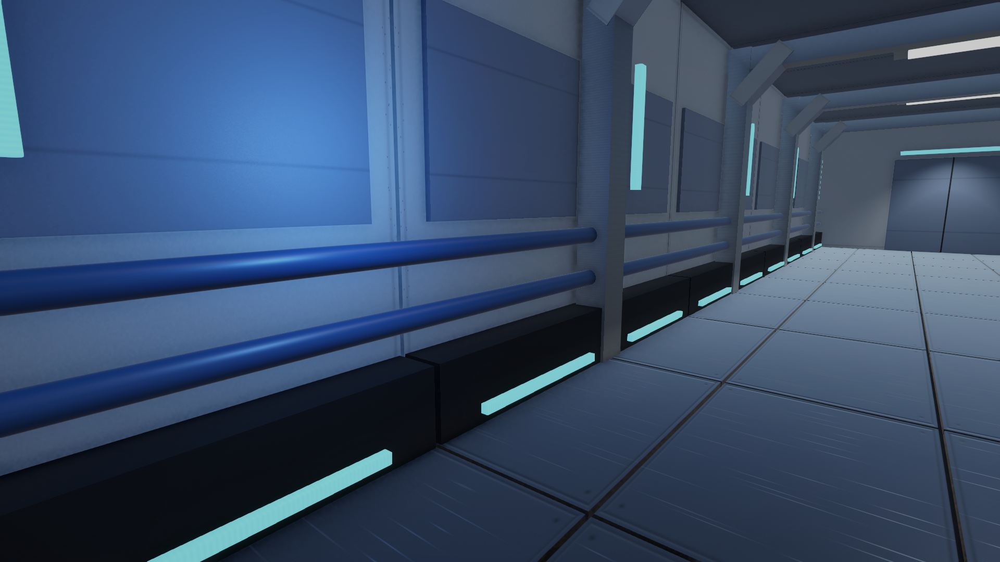

## 가상 화면을 참고한 구도·라이팅 조정

단순 재질 테스트에서 실내 화면 분위기를 확인할 수 있도록 현재 씬을 확장했다. 이전 구성은 비활성화하거나 사본으로 보관했다. 기존 리브·짧은 사선 부재 대신 `CorridorTest/ReferenceLookPass` 아래에 하단·상단 사선이 있는 벌크헤드, 매입형 조명, 서비스 박스·환기구, 천장 파이프를 배치했다.

- Main Camera: 위치 (0.10, 1.36, -1.85), FOV 60. 캐릭터에 가까운 후방 시점.
- 벽을 밝은 도장색으로 조정하고 벽을 향하는 Spot Light 10개와 약한 캐릭터 측면 색조 조명을 추가했다. 전체 조명 비용은 아직 최적화하지 않은 테스트 구성이다.
- `CorridorLook_GlobalVolume`: Global Volume, Priority 20, Weight 1. Default 레이어 사용.
- `Data/CorridorLookProfile.asset`: ACES, Post Exposure +0.70EV, Contrast 5, Saturation -8. Bloom Threshold 1.1 / Intensity 0.30 / Scatter 0.55. Vignette Intensity 0.12.
- URP HDR 및 카메라 HDR·Post Processing, 카메라 Volume Mask, Renderer의 PostProcessData 연결을 확인했다. 후처리 프로필은 이 테스트 씬에서만 참조한다.

### 실시간 바닥 반사

`PolishedFloorReflection`의 `CorridorPlanarReflection` 컴포넌트는 Main Camera를 바닥 평면 아래로 반사한 카메라로 추가 렌더링하고, `Corridor Floor Reflection` 셰이더가 PBR 타일 위에 결과를 혼합한다. 원본 카메라를 대상으로만 동작하며 다른 비교 카메라는 일반 PBR 바닥과 기존 프로브 반사만 표시한다.

- 기본 해상도는 원본 가로·세로의 각 0.5배다. 화면 해상도가 바뀌면 재할당한다.
- 반사 카메라에서 후처리·실시간 그림자는 생략하여 이중 후처리와 추가 그림자 비용을 줄였다. 반사 속 그림자는 원본 뷰와 완전히 동일하지 않을 수 있다.
- 바닥 아래를 자르는 사선 클립 평면, 반전 컬링, 플랫폼에 따른 세로 UV 방향을 처리했다.
- `Materials/Corridor/CorridorFloorReflection.mat`: Strength 0.58, Tint 흰색, Blur 1.9px. 시선각과 타일 틈 마스크를 적용한다. 반사막 자체는 일반 물리 재질 바닥 위의 보조 효과이며, 바닥 BRDF의 완전한 대체가 아니다.
- Main Camera를 렌더할 때 복도를 한 번 더 그리므로 비용이 증가한다. 테스트 장면에서는 확인했지만 목표 기기 성능 검증이나 다중 카메라·XR 지원을 완료한 것은 아니다.
- 컴포넌트 비활성화 시 임시 카메라와 RenderTexture를 해제한다. 반사 전후 비교는 컴포넌트 또는 해당 Renderer를 끄면 된다.

### 검증 및 남은 차이

- 편집 모드·Play 모드에서 반사 렌더 확인. Play 모드에서 임시 반사 카메라가 1개이며 RenderTexture가 생성된 것을 확인했다.
- 평면 반사 Off/On 화면 비교 후 On 상태로 복원.
- Play 모드 Console 오류·경고 없음, 반사 셰이더 컴파일 메시지 없음.
- 기존 UnityChan 패키지의 중복 타입 CS0436 경고는 스크립트 재컴파일 때 나타날 수 있으며 이번 변경 범위에는 포함하지 않았다.
- 푸시아는 제공된 A포즈 메시 그대로다. 가상 화면의 자연스러운 자세·의상 실루엣·배경의 정교한 모델 디테일까지 재현한 결과는 아니다. 현재 장면은 구도·조명·재질 방향성을 평가하는 프로토타입이다.

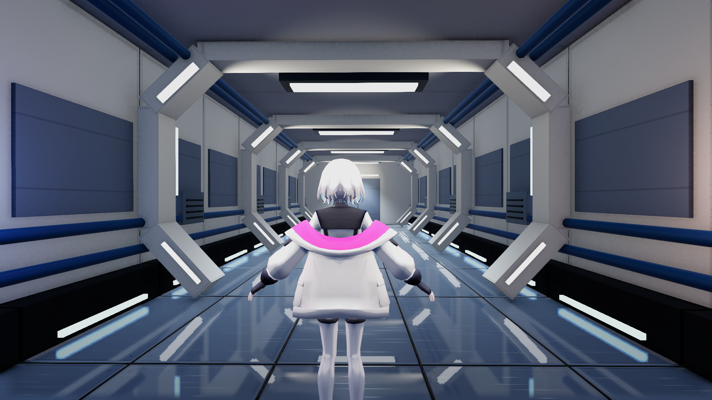

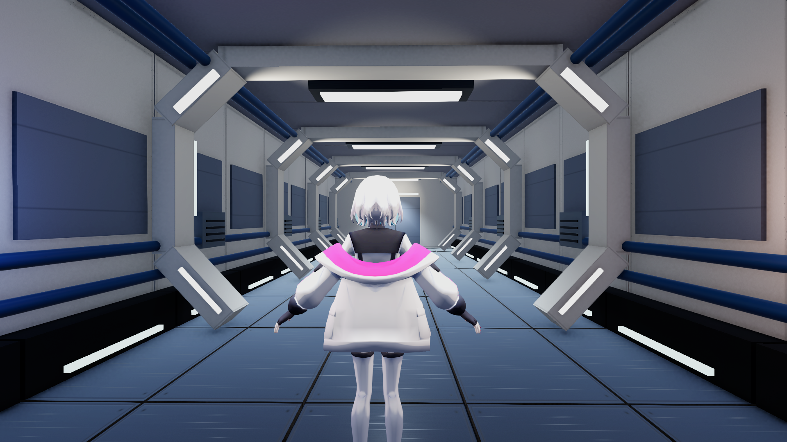

## 재질별 형상 디테일 및 캐릭터 광량 보정

`SurfaceDetailPass` 아래에 금속 체결부, 도장 서비스 덮개, 파이프 연결·클램프, 표식, 출입문 손잡이를 추가했다. 단순한 입방체를 유지한 채 색만 바꾸는 대신 패널·프레임의 실제 모서리와 작은 부품도 보완했다.

- 85개 벽 패널·벌크헤드·서비스 하우징·도어·조명 하우징에 모서리를 깎은 메시 적용. 반복되는 크기는 공유 메시 자산 9개로 저장했다. 기존 BoxCollider의 크기는 실제 크기에 맞춰 유지했다.
- 생성 함수: `Editor/CorridorDetailMeshBuilder.cs`. 메시 자산은 `Models/Corridor/`에 저장했다.
- 표면 디테일 오브젝트 194개: 프레임 나사·슬롯, 파이프 커플링과 고정 앵커, 서비스 덮개와 손잡이, 작은 도장 손상, 층 안내판 및 장착부, 도어 체결부.
- `ExposedFastenerMetal`: 노출 금속 나사·연결부용 재질.
- `ServiceHousingMetal`: 서비스 하우징용으로 광택을 줄인 금속 재질.
- 표식은 배경 표면에 부착하는 알파 테스트 URP/Lit 메시이며 UI가 아니다. `GenerateCorridorLabels.py`로 생성한 서비스·주의·층 안내 텍스처 3종을 사용한다.
- 반복 소품을 빠르게 배치한 프로토타입이다. 구조물·배선·환기 장치 전체를 실물 설비처럼 모델링하거나 제작용 게임 환경 에셋을 완성한 것은 아니다. 현재 소품 수에 따른 드로 콜 최적화는 별도 작업이 필요하다.

### 푸시아의 과도한 밝기

광원 여러 개가 합산되고 전역 노출이 올라간 상황에서 흰 옷과 머리의 텍스처가 날아가는 현상을 완화했다. 캐릭터 셰이더에 `Direct light response`와 `Direct light brightness ceiling`을 추가했다. 머티리얼의 직접광만 줄이고 RGB를 같은 배율로 제한하므로 주변 광원 색과 그림자 한 단계 구조는 유지한다. 배경 광원·전역 노출은 이 보정 때문에 낮추지 않았다.

| 부위 | Direct light response | Direct light brightness ceiling | Environment and probe fill |
|---|---|---|---|
| 머리 | 0.42 | 0.80 | 0.80 |
| 얼굴·눈·손 | 0.45 | 0.85 | 0.80 |
| 옷·장신구 | 0.52 | 1.05 | 0.80 |

광택과 테두리 빛에도 Direct light response를 적용한다. 기존 직렬화 필드와 텍스처 연결은 유지했다. 렌즈에는 해당 보정 필드를 추가하지 않았다.

### 검증

- 같은 카메라·모델 위치에서 직접광 반응 1 / 상한 4 / 환경광 1의 비교 화면을 촬영한 뒤 위 기본값으로 복원했다.
- 전체 화면과 근접 렌더, Play 모드 렌더 확인.
- 캐릭터 셰이더 오류 없음, 배경 MeshFilter의 메시 누락 없음, Play 모드 Console 오류·경고 없음.
- 재질·디테일 변경 후 Reflection Probe를 갱신하고 편집 모드에서 씬을 저장했다.

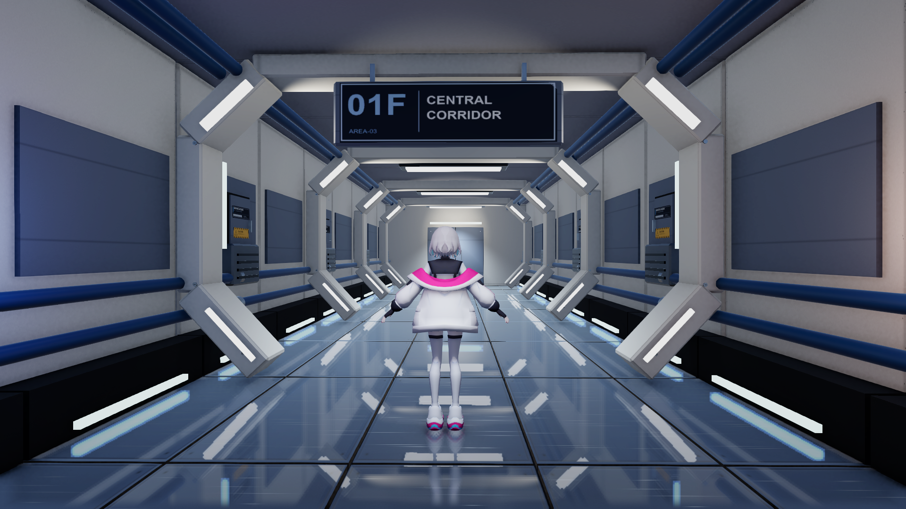

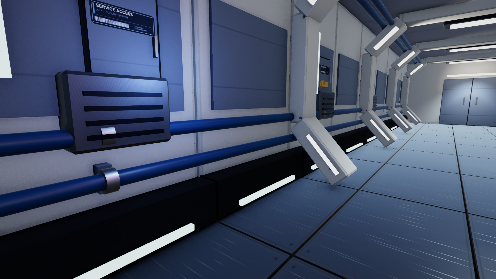

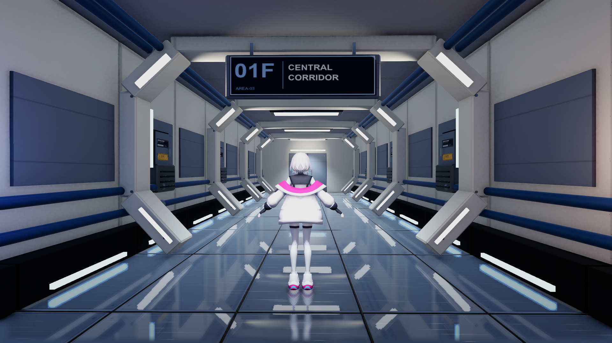

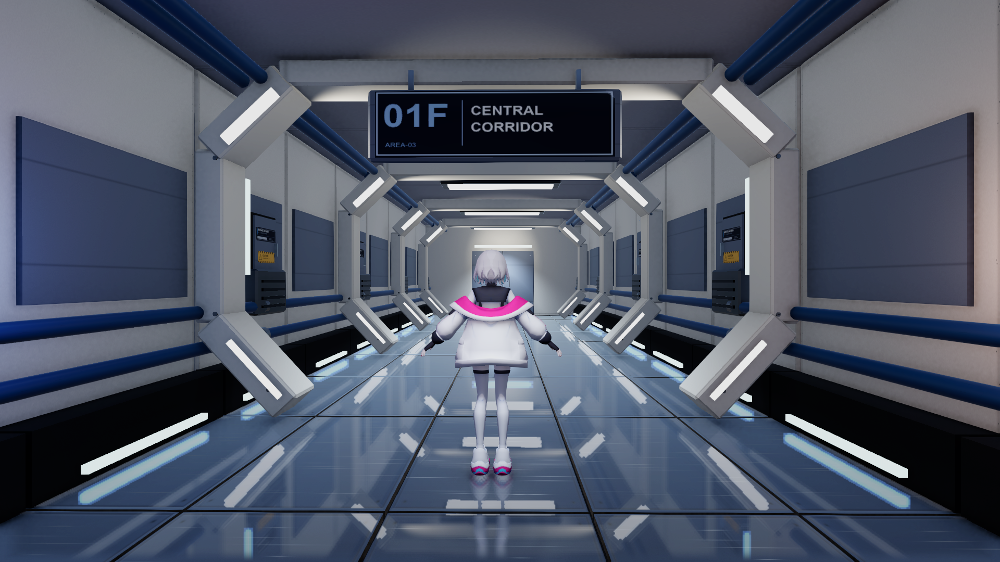

## 벽의 반광 코팅

벽이 점토처럼 보이는 거친 표면을 줄이고, 밝은 청회색 도장과 안쪽 청회색 패널에 코팅 반사를 추가했다. 바닥의 평면 반사와 달리 벽은 URP Complex Lit의 Clear Coat와 기존 Reflection Probe를 사용한다.

- `WallPaint`: 별도 `wall_coated` 맵, Smoothness 약 0.69, Normal 강도 0.12, Clear Coat Mask 0.50 / Smoothness 0.82. 바탕 도장은 비금속이며 작은 도장 손상만 노출 금속으로 처리한다.
- `WallInsetCoating`: 벽 안쪽 패널 24개에 별도로 연결. Smoothness 약 0.66, Normal 강도 0.12, Clear Coat Mask 0.50 / Smoothness 0.82. 기존 문 전용 `DoorPaint`와 분리해 문의 표면은 유지했다.
- 표면 알베도의 입자 대비와 노멀 요철을 줄이고 기존 패널 홈은 유지했다. 천장은 기존 무광 벽 맵을 계속 사용한다.
- 반사 Probe 해상도 128 → 256, 재질 적용 후 재베이크. 벽 전용 실시간 반사 카메라는 추가하지 않았다.
- 맵 재생성: `python Docs/Tools/GenerateCorridorSurfaceMaps.py`. 총 10종 × 3개 맵이며 벽 코팅용 두 종류는 기존 맵과 분리했다.
- 근접·전체 카메라 및 Play 모드 화면 확인. Complex Lit 셰이더 오류 없음. Play 전환 시 MCP WebSocket 초기화 경고 1건이 있었고, 이후 도구 연결은 정상 복구됐다.

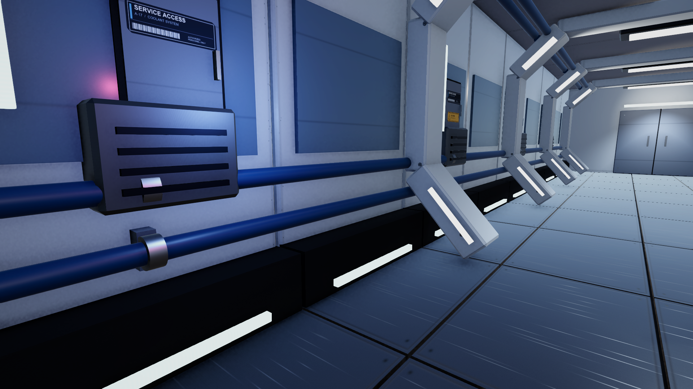

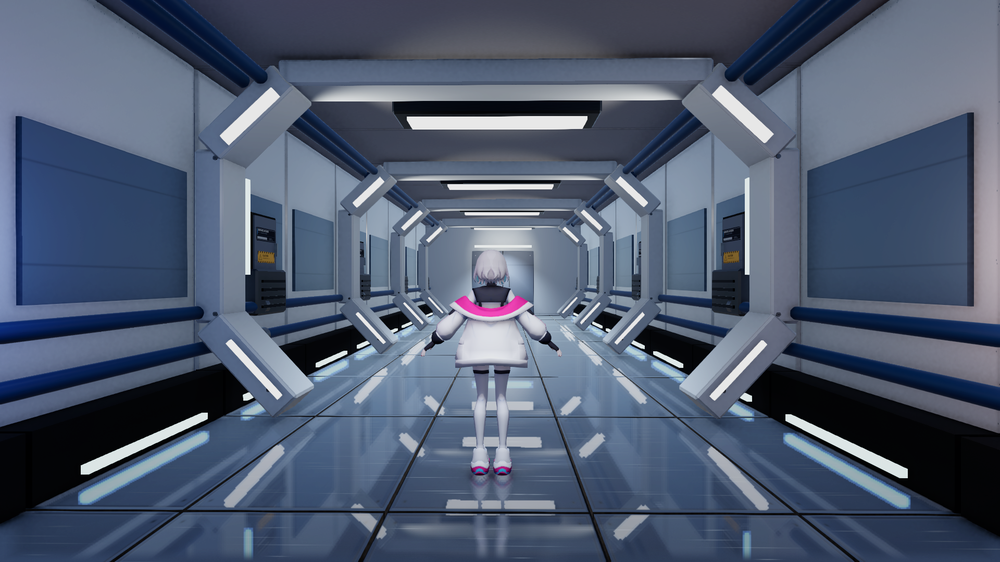

### 벽 메탈릭 강화 — 비교 단계

후속 요청에 따라 도장 느낌보다 금속 느낌이 드러나도록 `WallPaint`의 메탈릭 맵 R을 0.82(손상부 0.90), `WallInsetCoating`은 0.75로 올렸다. 위 반광 코팅 단계의 비금속 설정을 대체한다. 두 머티리얼은 Metallic Map을 사용하므로 Inspector의 Metallic 값만 바꾸지 않고 실제 맵을 수정했다. Smoothness·색·광원은 유지해 메탈릭 차이를 확인했다. 반사 Probe를 다시 베이크하고 근접·전체 렌더를 확인했으며 셰이더 및 Console 오류는 없다.

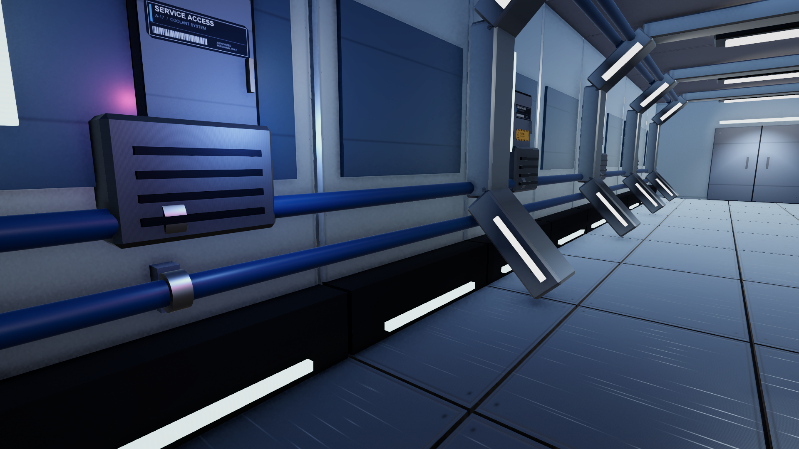

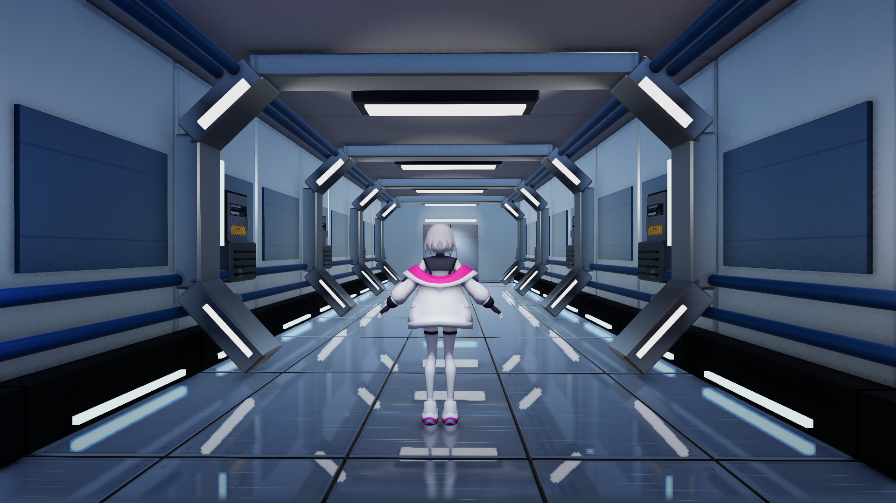

## 벽 구조·주광과 보조광·재질 분리 — 현재 설정

`WallArchitecturePass`에 좌우 12구간씩, 총 24개 벽 모듈을 추가했다. 카메라와 푸시아의 위치는 유지한 상태에서 같은 구도로 비교했다.

- 실제로 들어간 패널과 약 22cm 앞으로 나온 도장 프레임, 안쪽 고무 가스켓, 노출 금속 모서리·체결부, 상부 분할 덮개를 추가했다.
- 파란 배관 뒤에 어두운 설비 채널을 두고 하부에는 경사진 환기구와 별도 금속 날개를 추가했다. 기존 환기함은 새 프레임에 가리지 않도록 배관 높이로 옮겼고 서비스 표식도 새 패널 면 앞으로 이동했다.
- 기존 평면 `WallInset` 24개는 Renderer를 꺼서 보관한다. 새 모듈은 재질별로 합친 메시 6개를 공유하며 144개 Renderer를 사용한다. 기존 벽 충돌체는 유지하며 새 장식 형상에는 별도 충돌체를 추가하지 않았다.

### 조명

- 따뜻한 주광: Directional Light, 천장 Spot 6개, 벽을 비스듬히 비추는 Spot 10개. 천장은 RGB `(1, 0.91, 0.82)`, 벽은 `(1, 0.91, 0.80)`이며 주황색으로 과도하게 물들지 않도록 조절했다.
- 차가운 보조광: 좌우 기존 Fill과 하부 파란 Point 10개. 하부 금속·배관에 파란 반사를 만들며 새 Point에는 그림자를 켜지 않았다.
- 가까운 벽 Spot 2개에만 추가 그림자를 켜고, 기존 천장 그림자와 함께 프레임 안쪽 음영을 만든다.
- 전역 환경광을 낮춰 밝은 면과 채널·홈의 차이를 확보했다. 환경광은 남겨 캐릭터의 한 단계 그림자에도 들어간다. 캐릭터 직접광 반응·밝기 상한은 기존 설정을 유지했다.
- 발광부 색도 따뜻한 흰색 / 파란색으로 나누고, 구조·재질·조명 변경 후 Reflection Probe를 다시 베이크했다.

### 재질

| 부위 | 메탈릭 맵 | Smoothness 기준 | 표현 |
|---|---|---|---|
| 밝은 벽·프레임 | 도장 0, 손상부 0.85 | 0.59 + 약한 Clear Coat | 밝은 도장 |
| 안쪽 회청색 패널 | 0.58 | 0.62 | 금속 반사 강조 |
| 얇은 테두리·환기 날개 | 0.96 | 0.58 | 노출 금속 |
| 나사·배관 커플링 | 0.96 | 0.58 | 밝은 노출 금속 |
| 파란 배관 | 코팅 0, 손상부 0.9 | 0.56 | 코팅과 금속 연결부 구분 |
| 설비 채널 | 0.92 | 0.43 | 거친 어두운 금속 |

이 설정은 앞선 벽 전체 메탈릭 0.82/0.75 비교 단계를 대체한다. 파란 배관·노출 금속·구조용 강철의 색과 미세 노멀 강도도 개별 조정했다. 바닥의 강한 반사와 고무 가스켓의 무광은 유지한다.

### 재적용·검증

1. 프로젝트 루트에서 `python Docs/Tools/GenerateCorridorSurfaceMaps.py` 실행.
2. Edit 모드의 FuchsiaShadowTest에서 `Docs/Tools/ApplyCorridorArchitecture.cs` 내용을 MCP `execute_code`의 메서드 본문으로 실행.
3. `Docs/Tools/ApplyCorridorLighting.cs`도 같은 방식으로 실행. 이 두 파일은 Unity 컴포넌트 소스가 아니라 외부 저작용 메서드 본문이며 `Assets` 밖에 보관한다.
4. 반사 Probe 재베이크 후 씬 저장. 구조 스크립트 재실행은 기존 이름의 패스만 교체하므로 조명 스크립트를 이어서 실행한다.

- 편집·Play 모드 전체 화면과 근접 렌더 확인. Play 모드에서 평면 반사 활성, 벽 그림자 Spot 2개, 전체 활성 Light 30개 확인.
- 새 모듈의 메시·재질 누락 0개, Complex Lit 셰이더 오류 0개, Play 모드 Console 오류·경고 0건.
- 카메라 위치 `(0.10, 1.36, -1.85)` / FOV 60, 푸시아 위치 `(0, 0, 1.31)` 유지. 편집 모드로 복귀했다.
- 배경은 여전히 반복 모듈로 만든 프로토타입이다. 참고 이미지의 복잡한 설비 모델·자연스러운 캐릭터 자세·가까운 카메라 구도까지 재현한 결과는 아니다. 실제 게임 성능에 맞춘 전체 배칭·광원 최적화는 별도 확인이 필요하다.

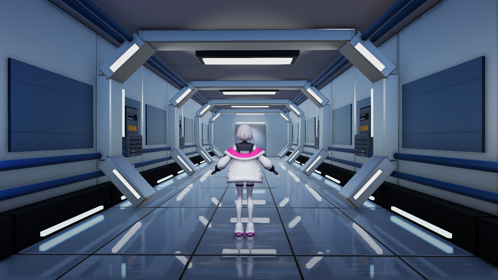

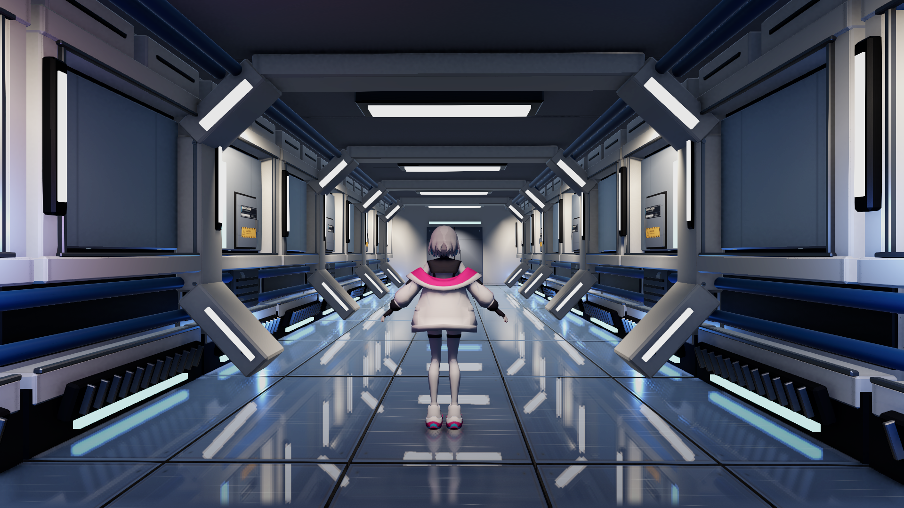

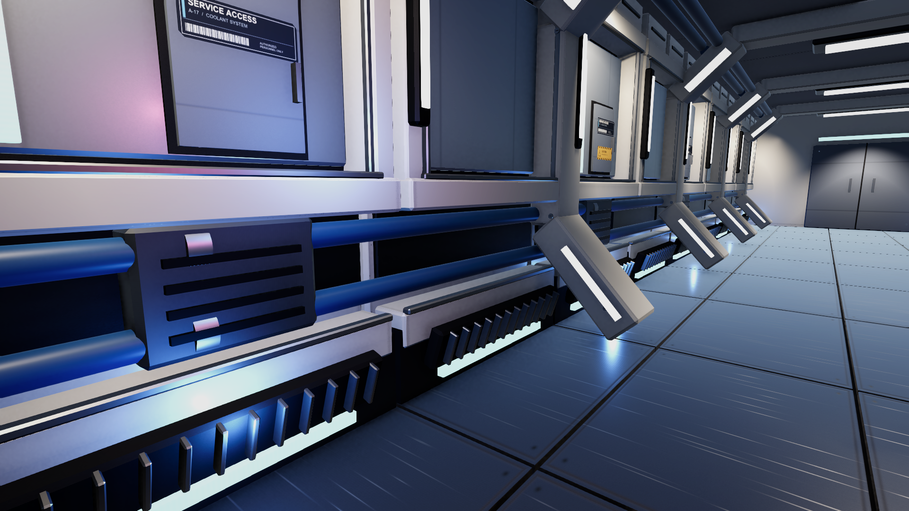

## 푸시아의 카툰 음영 가독성

한 단계 경계를 적용한 뒤에도 연속적인 Lambert 명암을 최종 색에 곱하고 있어 일반적인 부드러운 셰이딩이 강하게 남아 있었다. 경계 입력도 직접광 밝기의 절댓값이라 추가 광원의 수와 강도에 따라 밝은 면으로 치우칠 수 있었다.

- `FuchsiaLighting.hlsl`: 법선에 따른 직접광, 그림자를 반영한 입사광 색, 법선·그림자로 감쇠하기 전의 입사광 휘도를 함께 집계한다. 렌즈의 기존 호출 형식과 주광원 선택은 오버로드로 유지한다.
- `FuchsiaToonCommon.hlsl`: 직접광 휘도를 입사광 휘도로 정규화한 0~1 값에 한 번만 경계를 적용한다. 최종 색에는 연속적인 N·L을 다시 곱하지 않는다. 거리 감쇠와 광원 색, 실제 투영 그림자는 계속 반영한다.
- 환경광 `SampleSH(normal)`은 실제 그림자 감쇠에 곱하지 않고 유지하며, 밝은 면·그림자 면에 맞는 색조를 적용한다. 기존 환경광 강도 0.8과 직접광 반응·밝기 상한은 유지한다.
- 한 단계 그림자 색과 경계를 부위별로 조정했다. 경계 Feather와 화면 미분을 이용한 안티앨리어싱은 유지한다.

| 부위 | 경계 | Feather | 그림자 색 RGB |
|---|---|---|---|
| 머리 | 0.38 | 0.014 | (0.59, 0.62, 0.76) |
| 코트·몸통·치마·리본·장신구 | 0.38 | 0.014 | (0.54, 0.60, 0.74) |
| 다리 | 0.30 | 0.018 | (0.64, 0.68, 0.80) |
| 신발 | 0.34 | 0.014 | (0.58, 0.64, 0.76) |
| 얼굴·손 | 0.24 | 0.025 | (0.84, 0.73, 0.77) |

눈은 약한 Shading Strength 0.15를 유지하며 경계 0.38 / Feather 0.009를 사용한다. 텍스처·부위별 재질 연결과 안경 렌즈의 투명 설정은 유지했다. 배경 조명·재질과 메인 카메라·모델 위치는 이 수정으로 바꾸지 않았다. 근접 비교용 `ToonDetailCamera`를 추가했으며 비활성 Camera 컴포넌트로 보관한다.

### 검증

- 동일한 근접 카메라에서 수정 전·후 촬영, 정면·메인 카메라에서 머리·소매·코트의 음영 경계 확인.
- Hair / Face / Cloth / Accessory / Lens 셰이더의 컴파일 메시지 0개. 외부 HLSL 수정 후 첫 임포트 때 발생한 AssetDatabase 수정 시각 불일치 오류는 include와 종속 셰이더를 순서대로 재임포트해 해결했다.
- Play 모드의 전체 렌더 확인, Console 오류·경고 0건.
- Play 모드에서 추가 광원을 잠시 꺼 비교했다. 천장에 가려진 캐릭터가 푸른 환경광으로 계속 보이는 것을 확인했다. 편집 모드 복귀 후 활성 광원 30개와 환경광 강도 0.8 복원 확인.
- 씬과 머티리얼 저장 완료. 카툰 경계는 실제 메시 법선과 투영 그림자를 따르므로 머리의 형태·자세에 따른 경계 모양은 남는다. 얼굴 전용 SDF나 별도 노멀 보정 맵을 추가한 작업은 아니다.

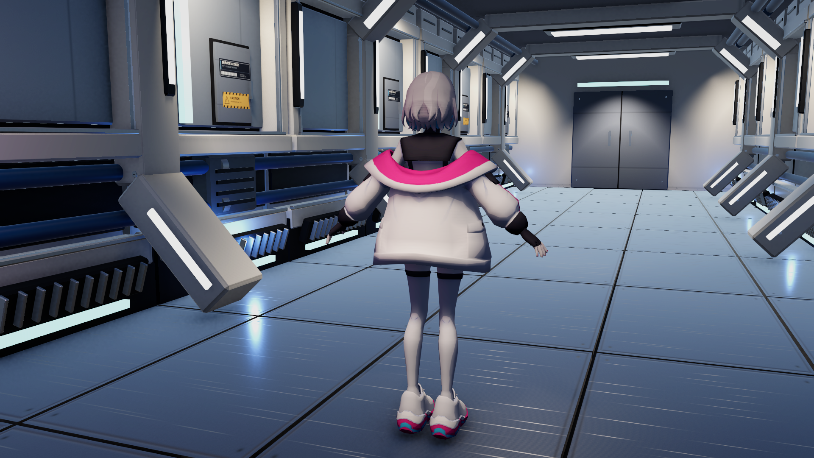

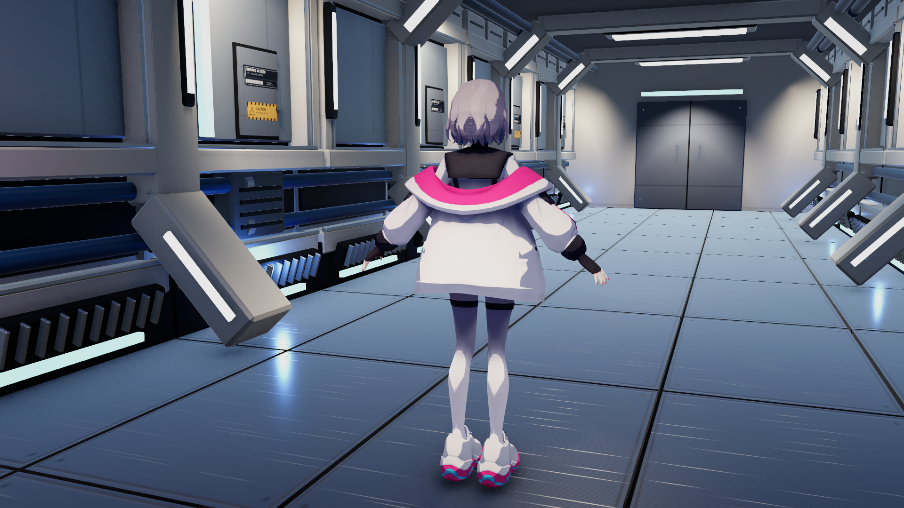

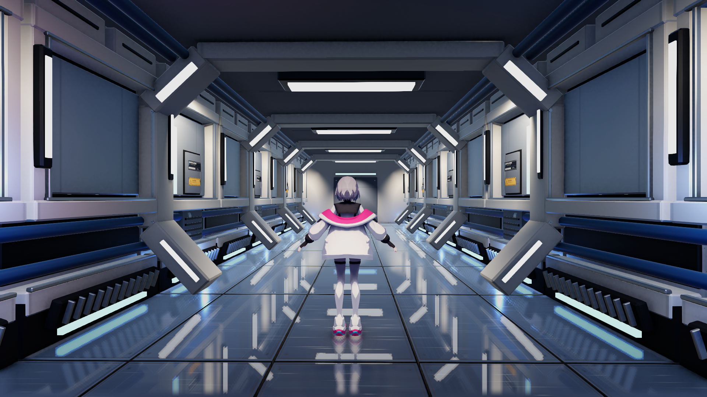

## 푸시아 간단 이동

Play 모드에서 Game 창을 클릭한 뒤 조작한다.

- WASD / 방향키: 카메라 기준 이동, 이동 방향으로 회전.
- Shift: 빠른 이동. 기본 1.7m/s, 빠른 이동 2.8m/s.
- R: 시작 위치·방향과 카메라 구도 초기화.
- 카메라는 기존 각도와 거리를 유지하며 위치를 따라간다. 마우스 회전·커서 잠금·점프는 추가하지 않았다.

`Scripts/FuchsiaTestMovement.cs`를 새 `FuchsiaMovementRig`에 연결했다. 모델 피벗이 몸 뒤쪽에 있어 회전 시 충돌 캡슐이 옆으로 밀리는 문제를 피하도록, 몸 가운데에 이동용 부모를 두었다. 자식 `Fuchsia_Toon`의 편집 시 월드 위치·방향은 유지한다. 캡슐은 높이 1.6m / 반경 0.27m이며 바닥·기존 복도 충돌체를 사용한다. 카메라와 장식물 간격을 위해 X -1.8~1.8m / Z -2~15.5m로 이동을 제한한다.

현재 FBX의 `Take 001`은 약 0.033초의 포즈이며 실제 걷기 클립이 아니다. Animator·걷기 동작을 추가하지 않았으므로 제공된 A포즈를 유지하며 위치와 방향만 움직인다. 이 기능은 조명·카툰 음영을 이동하면서 확인하는 테스트용이다.

### 확인한 동작

- Play 모드에서 실제 이동 함수를 1/60초 간격으로 실행: 1초 전진 1.700m, 빠른 전진 2.800m, 대각선 이동 1.700m. 대각선 속도 증가 없음.
- 임시 Input System Keyboard 장치로 WASD 대각선 `(0.707, 0.707)`, 위 방향키 `(0, 1)`, 키 해제 `(0, 0)` 확인 후 장치 제거.
- 복도 이동 범위와 바닥 접지 확인. 이동 범위를 잠시 풀어 실제 측면 구조물 충돌도 확인한 뒤 기본 제한으로 복원했다.
- 전진·좌회전 후 카메라 추적 확인, R이 사용하는 초기화 함수로 위치·방향·카메라 복원 확인.
- Play 모드 Console 오류·경고 0건. 스크립트 재컴파일 시 기존 UnityChan 패키지의 중복 타입 CS0436 경고는 별도로 나타났다.
- 편집 모드로 복귀 후 이동 스크립트 활성, 모델 위치 `(0, 0, 1.31)`과 원래 카메라 위치 복원, 씬 저장 확인.

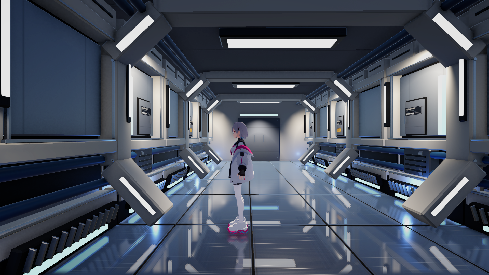

## 비교 카메라·얼굴 전용 음영·머리와 다리 보정

### 비교 카메라

기본 화면을 뒤쪽 확대 구도로 변경했다. Play 모드에서 Game 창을 클릭하고 **C**를 누르면 `뒤쪽 확대 → 정면 전신 → 얼굴 확대 → 기존 넓은 화면` 순서로 전환된다. WASD·방향키·Shift·R은 유지하며, R은 선택한 구도의 카메라 오프셋을 유지한 채 위치를 초기화한다.

- `WideComparisonCamera`: 기존 위치·방향과 FOV 60 보관.
- `ToonDetailCamera`: 뒤쪽 확대, FOV 44. 기본 Main Camera 구도로 사용한다.
- `FrontComparisonCamera`: 정면 전신, FOV 40.
- `FaceDetailCamera`: 얼굴 확대, FOV 32.
- 비교 카메라는 모두 비활성 템플릿이다. C키는 실제 Main Camera의 위치 오프셋·방향·FOV를 바꾸므로 활성 카메라·AudioListener를 늘리지 않으며 기존 평면 반사도 유지한다.

### 얼굴

`Face Toon`에 얼굴 전용 그림자 임곗값 맵과 머리 기준 좌표를 추가했다. 광원들의 입사 휘도로 가중한 방향을 머리의 앞·옆 축으로 투영하고, 좌우에 따라 맵을 반전해 볼과 코 주변의 그림자 모양을 제어한다. 실제 유클리드 거리장을 구운 SDF가 아니라 이 모델에 맞춰 해석적으로 만든 임곗값 필드다.

- `GenerateFuchsiaFaceMask.py`로 256×256 선형 데이터 맵 생성. 색 텍스처·방향광을 구운 이미지가 아니며 sRGB Off / Clamp / Bilinear / Mipmap Off로 임포트한다.
- 얼굴 앞면에서 전용 마스크를 사용하고 뒷면은 기존 카툰 계산과 연결한다. 얼굴 재질만 Face Style 1 / Feather 0.045 / 환경광 보충 0.65 / Received Shadow 0.5를 사용한다. 손·눈에는 얼굴 마스크를 켜지 않았다.
- 위쪽 환경광을 추가로 받아 눈 주변 가독성을 확보한다. 별도 발광이나 얼굴 전용 조명 오브젝트는 추가하지 않았으며 환경광을 줄이면 이 보충광도 줄어든다.
- `FuchsiaLighting.hlsl`의 기존 렌즈 호출 형식은 유지했다. 추가 광원 색·거리 감쇠·그림자·기존 밝기 상한도 유지한다.

### 머리·다리

- 머리는 타원체를 기준으로 한 음영용 노멀을 0.65만큼 혼합해 모발 조각마다 다른 명암 경계를 완화했다. 높이 0.62 / 반폭 0.035 / Feather 0.02의 투영 띠 광택을 사용하며, 시점과 머리 곡률에 따라 띠를 조금 휘게 한다. 광택 밝기는 입사광 휘도로 제한한다.
- 머리의 환경광 보충은 0.30, Received Shadow는 0.80, 그림자색은 `(0.68, 0.70, 0.81)`로 조정했다. 원래 끝부분의 청색 텍스처는 유지한다.
- 다리는 각 다리의 긴 축을 따르는 원통형 음영 노멀을 사용한다. 무릎에서 위를 향하는 실제 노멀 때문에 생기던 작은 밝은 반점을 세로 음영으로 정리했다. 경계 0.16 / Feather 0.025 / 그림자색 `(0.73, 0.77, 0.86)`이다.
- `ApplyFuchsiaStyleMeshes.cs`를 MCP `execute_code`의 메서드 본문으로 실행해 얼굴·머리·다리 Renderer 12개에 보정 메시를 연결했다. `Models/CharacterStyle/`에 저장하며 원본 FBX·UV0·정점 위치·실제 표면 노멀·그림자 투영 형상은 유지한다. UV1은 음영 노멀, UV2는 투영 좌표다.
- 원본 메시처럼 보정 채널이 없는 경우에는 기존 셰이딩으로 돌아가도록 음영 노멀 채널을 검사한다. 정적 모델의 현재 자세·크기에 맞춘 데이터이므로 리깅이나 모델 비율을 바꾸면 다시 생성·조정해야 한다.

### 검증

- 동일한 얼굴·정면·뒤쪽 비교 카메라에서 전후 렌더 확인.
- Play 모드에서 C키가 호출하는 4개 구도 순환 함수, 구도 전환 후 1초 이동 약 1.700m, 카메라 추적 및 R 초기화 함수 확인. 평면 반사 활성 확인.
- Play 모드에서 일시적으로 단일 측면 광원으로 바꾸어 좌우 얼굴 그림자의 반전 확인 후 복도 광원 30개와 원래 주광원 Soft Shadow 복원.
- 보정 메시 12개의 정점 좌표가 원본과 동일한 것을 확인. Hair / Face / Cloth / Accessory / Lens 셰이더 컴파일 메시지 0개, Play 모드 Console 오류·경고 0건.
- 편집 모드 복귀, 기본 뒤쪽 확대 구도와 모든 비교 카메라 연결·머티리얼·씬 저장.

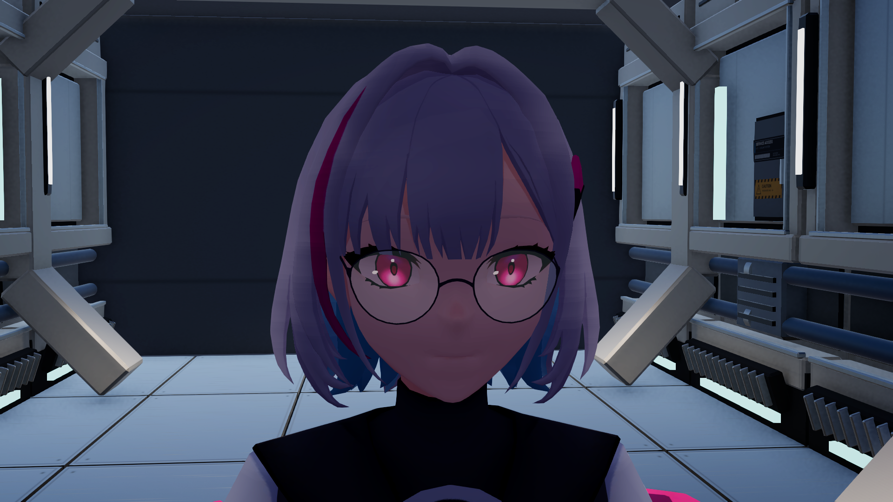

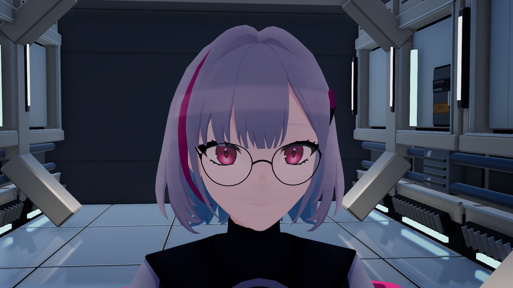

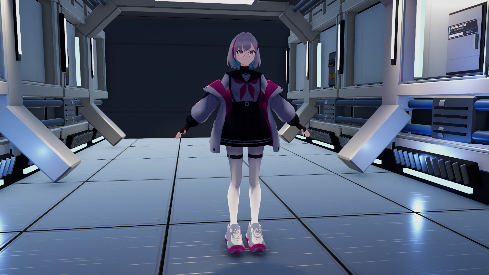

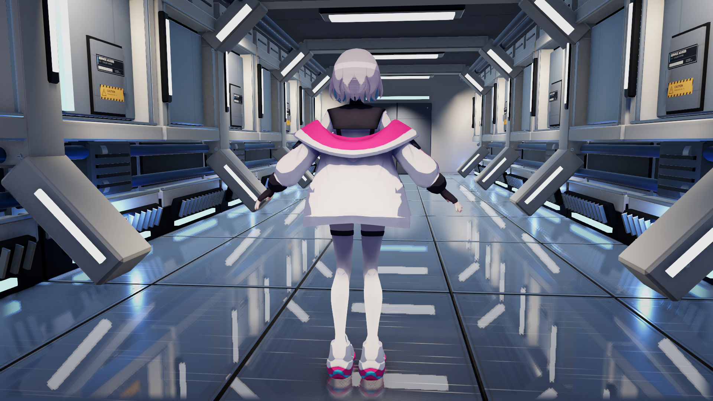

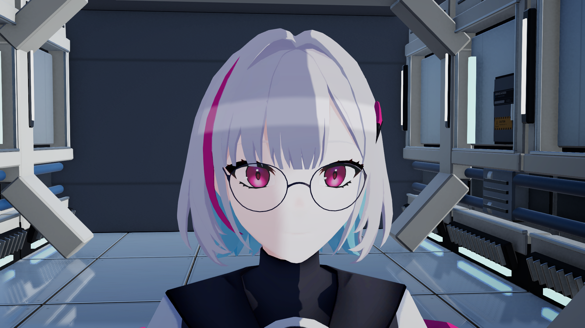

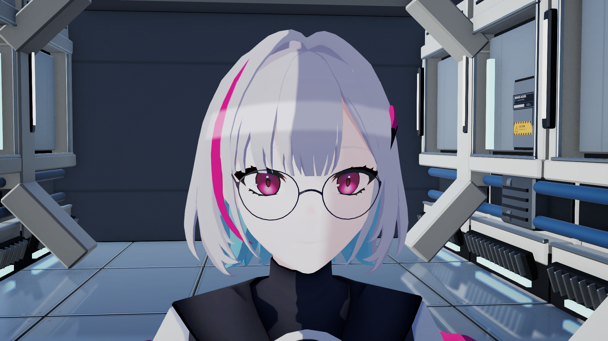

## 주광·보조광 분리와 얼굴·앞머리·머리 광택 (2026-10-20)

### 적용한 표현

- `FuchsiaLighting.hlsl`: URP 주광만 카툰 경계와 얼굴 방향에 사용한다. 보조광은 거리 감쇠·그림자·면 방향을 반영한 색 보충으로 더하며, 휘도에 따라 RGB를 같은 비율로 압축한다. 기본 보조광 Gain 0.16 / Ceiling 0.18 / 그림자 안 보충 0.35다. 주변광은 SampleSH를 유지한다.
- `FuchsiaToonCommon.hlsl`: 광원 전체의 평균 방향·평균 밝기로 명암을 정하던 계산을 제거했다. 밝은 면과 그림자 면의 한 경계를 유지하고, 보조광이 얼굴의 좌우 음영 방향을 바꾸지 않게 했다. 렌즈의 광택 방향도 주광으로 고정했다.
- 얼굴: 머리 기준 주광의 수평 각도를 그림자 임곗값으로 사용한다. 얼굴 제어맵의 볼·코·턱 경계를 보완하고 PNG의 위아래 방향을 UV에 맞췄다. Face Offset 0.12 / Feather 0.025 / 환경광 보충 0.35 / 그림자색 (0.80, 0.71, 0.76)이다. 이 맵은 여전히 해석적 임곗값 필드이며, 아티스트가 구운 유클리드 SDF라고 부르지 않는다.
- 앞머리 그림자: `FuchsiaHairShadowFeature`가 머리 재질의 `FuchsiaHairDepth` 패스만 별도로 그린다. 양의 시선 깊이를 R32 float에 저장하고, 얼굴에서 주광 방향으로 0.035m 이동한 지점과 비교한다. Bias 0.003m / 강도 0.75. 앞머리 아래의 이마·눈 위쪽에 적용하며, 얼굴의 기본 그림자와 최솟값으로 합쳐 새로운 그림자색 단계를 만들지 않는다. 눈동자·안경은 별도 재질을 유지한다.
- 머리 광택: `GenerateFuchsiaHairControl.py`로 512×256 선형 데이터 맵을 만든다. R은 광택 적용 범위, G는 띠 높이, B는 폭이다. 원통 투영으로 머리 앞·옆·뒤에 연결하며 U Repeat / V Clamp / sRGB Off / Mipmap Off / Uncompressed로 임포트한다. 광택 강도 0.65 / 반폭 0.033 / Feather 0.012 / Received Shadow 0.50이다. 주광·시점에 반응하며, 모발 덩어리 사이에서 띠가 끊기고 휜다.

원본 FBX와 기존 보정 메시의 형상·UV0·정점은 이번 작업에서 바꾸지 않았다. 기존 14개 부위 재질과 이동·C키 구도 전환을 유지한다. 확인하기 쉽도록 기본 구도를 얼굴 확대(인덱스 3)로 저장했다.

### 렌더러 연결

`Data/FuchsiaTestRenderer.asset`은 기존 PC_Renderer의 복사본에 머리 깊이 Feature만 추가한 전용 렌더러다. 기존 SSAO 설정을 유지한다. `PC_RPAsset`의 Renderer List 끝에 인덱스 1로 추가했고 기본 Renderer 인덱스 0은 유지한다. 테스트 씬의 실제 카메라와 비교 카메라를 인덱스 1로 연결했다. `CorridorPlanarReflection`에 Renderer 인덱스를 추가해 바닥 반사 카메라도 같은 설정을 사용한다.

Feature는 FuchsiaShadowTest 씬만 대상으로 한다. 머리 제어맵·재질·렌더러 연결은 `Docs/Tools/ApplyFuchsiaKeyFill.cs`의 MCP 실행 본문으로 다시 적용할 수 있다. 일반 배경 재질이나 기존 PC_Renderer 자체는 변경하지 않았다. Scene View가 기본 Renderer 0을 사용하면 전용 머리 깊이 효과는 Game View와 다르게 보일 수 있다. 최종 비교는 Main Camera의 Game View로 한다.

### Render Graph 검증

1. **검증 요약:** Unity 6000.3.23f1 / URP 17.3.0의 실제 API와 렌더 결과로 확인했다. 커스텀 메시 렌더링이므로 raster pass를 사용한다.
2. **확인된 문제:** 최종 검증 시 신규 C#·셰이더 오류 없음. 초기 셰이더 재임포트 중 SourceAssetDB 수정 시각 불일치가 한 번 발생해 편집 모드의 전체 asset refresh 후 재확인했다.
3. **위험·가정:** 화면 깊이 기반이며 현재 한 캐릭터 테스트 기준이다. 여러 캐릭터가 겹치면 캐릭터별 ID/깊이 격리가 필요하다. Render Graph 비활성 호환 모드·XR·모바일 성능은 검증하지 않았다.
4. **적용한 수정:** 카메라 시작 때 유효 플래그를 초기화해 이전 카메라/비활성 Feature의 임시 텍스처를 재사용하지 않는다. Feature 해제 시 이벤트도 해제한다.
5. **코드 구성 확인:** 현재 그래프의 color descriptor에서 크기·배열 형식을 가져온 뒤 R32_SFloat / MSAA None / 독립 Depth32로 변경한다. RendererList를 명시적으로 선언하고 모든 PassData를 기록 시 할당한다. static 렌더 콜백을 사용한다. 얼굴의 후속 DrawObjects가 읽으므로 SetGlobalTextureAfterPass로 공개하며, URP의 UseAllGlobalTextures 소비 경로를 로컬 패키지 소스에서 확인했다. 카메라 컬러·깊이를 샘플링하지 않아 불필요한 ConfigureInput 요청은 없다.
6. **남은 검증 범위:** 다중 캐릭터·대상 기기 GPU 프로파일링은 별도 작업이다. 1920×1080에서는 R32와 Depth32의 원시 저장량이 합계 약 15.8 MiB이며 카메라별 그래프 임시 자원이다. 실제 메모리 최고점과 프레임 비용은 측정하지 않았다.

### 재현 코드에서 참고한 점

- [StarRailNPRShader 얼굴](https://github.com/stalomeow/StarRailNPRShader/blob/bf44567f389834b8be5e3095e5ff507caa8764fb/Shaders/Character/CharFaceCore.hlsl): 머리 기준 얼굴 방향과 얼굴/앞머리 음영의 역할 분리.
- [StarRailNPRShader 광원·재질](https://github.com/stalomeow/StarRailNPRShader/blob/bf44567f389834b8be5e3095e5ff507caa8764fb/Shaders/Character/Shared/CharRenderingHelpers.hlsl): 주광/추가광의 서로 다른 역할, 광택 제어 텍스처.
- [AnimeToonShader](https://github.com/Teeinn0730/AnimeToonShader/tree/7b3340db1b464545d339f74f48f0d0df18edf0c3/Assets/Shader/RenderFeature): 별도 머리 깊이 패스 구성.
- [Unity Graphics](https://github.com/Unity-Technologies/Graphics): 프로젝트에 설치된 URP 17.3 RenderObjectsPass / DrawObjectsPass / LitInput을 API와 재질 해석의 기준으로 사용했다.

외부 게임 모델·텍스처·패키지·HLSL 코드를 반입하지 않았다. 기존 푸시아 코드를 수정하고 Unity의 설치된 API를 사용해 독립적으로 작성했다.

## 현재 복도 모델·배경 셰이더 분석

공개 HoYo 재현 저장소에서 확인한 핵심은 캐릭터·파티클·후처리다. 해당 코드가 실제 젠존제/스타레일 배경 렌더러라고 확인할 근거는 찾지 못했다. 아래는 현재 프로젝트의 모델·재질·설치된 URP 소스를 직접 조사한 결과이며, 호요버스 내부 구현에 대한 단정은 아니다.

### 모델과 렌더링 구조

- `CorridorTest` 아래 Renderer 687개. 기본 Cube/Cylinder와 모서리를 깎은 패널, 재질별로 합친 벽 모듈을 사용한다. 벽 구조의 24개 구간은 여섯 종류의 공용 메시를 반복한다.
- 현재 큰 형태의 깊이는 있지만 개별 부품의 비대칭 형상·독립 UV·제작된 베이크 노멀·부위별 오염 데이터는 제한적이다. 셰이더 수치만으로 모델의 실루엣과 작은 구조를 만들 수는 없다.
- 벽 도장과 안쪽 패널은 `Universal Render Pipeline/Complex Lit`, 금속 프레임·바닥·고무·파이프 등은 `Lit`다. 캐릭터 카툰 계산과 분리되어 있다.
- 표면 데이터는 대체로 512×512의 반복 가능한 절차적 Base/Normal/Mask다. Mask는 R=Metallic / G=AO / A=Smoothness. sRGB Off로 임포트되어 있다.

### 실제 금속 값과 매끄러움

원본 PNG의 평균을 확인했다. 아래 매끄러움은 재질의 Smoothness 배율을 곱하기 전 값이다.

| 표면 | 금속 R 평균 | 매끄러움 A 평균 | 의미 |
|---|---:|---:|---|
| 벽 도장 | 0.001 | 0.590 | 도장면 대부분은 비금속, 작은 칩만 금속 |
| 안쪽 패널 | 0.580 | 0.620 | 반금속 표현의 패널 |
| 바닥 | 0.935 | 0.795 | 매끈한 금속, 흠집 부분에서 매끄러움 감소 |
| 프레임 | 0.961 | 0.580 | 노출 금속 |
| 구조용 철 | 0.922 | 0.430 | 프레임보다 거친 금속 |
| 고무 | 0.000 | 0.140 | 거친 비금속 |
| 파란 파이프 도장 | 약 0.000 | 0.560 | 칠이 벗겨진 작은 부분만 금속 |

URP `Shaders/LitInput.hlsl`의 `SampleMetallicSpecGloss`와 `InitializeStandardLitSurfaceData`를 확인했다. `_METALLICSPECGLOSSMAP`이 켜지면 금속성은 맵 R에서 직접 읽으며 `_Metallic` 슬라이더를 곱하지 않는다. 매끄러움은 맵 A × `_Smoothness`다. 따라서 **Metallic 슬라이더가 1이라는 사실만으로 벽 전체가 철이 되지 않는다.** 현재 벽은 의도적으로 도장 재질이며, 노출 프레임은 이미 금속성이 높다.

벽과 안쪽 패널에는 `_CLEARCOAT` 키워드가 활성이고 Coat Mask는 각각 0.28 / 0.18이다. 벽 Bump Scale은 0.08로 미세 표면의 영향도 작다.

### 가상 스크린샷과 차이가 남는 원인

1. **재질 변화의 위치가 획일적이다.** 대부분 작은 반복 노이즈와 패널 테두리다. 사람 손이 닿는 높이·바닥의 동선·패널 아래 먼지·프레임 모서리 마모처럼 사용 흔적의 위치를 정의하는 데이터가 부족하다.
2. **벽의 큰 도장면이 넓고 균일하다.** 금속성 증가보다 노출 금속 부품의 면적·모서리·거칠기 대비를 늘리는 것이 효과적이다. 안쪽 패널/프레임/도장 셸의 역할을 유지해야 한다.
3. **반사가 서로 다른 방식으로 합쳐진다.** 벽은 Reflection Probe 기반 PBR 반사, 바닥은 PBR 위에 반해상도 평면 반사를 투명 면으로 더한다. 바닥 반사의 5탭 블러는 재질의 거칠기 맵을 읽지 않으므로 흠집과 반사의 흐림이 완전히 연결되지 않는다. 이 때문에 바닥만 지나치게 거울처럼 보일 여지가 있다.
4. **반복 모듈의 형상이 단순하다.** 케이블 연결부·패널 잠금장치·환기구 안쪽 구조·문 주변의 고유 부품과 베이크 노멀이 있으면, 동일 PBR 셰이더에서도 질감 차이가 커진다.

다음 배경 작업 우선순위는 **부품별 거칠기/오염 마스크 → 바닥 반사의 거칠기 연동 → 눈에 잘 보이는 벽 모듈의 고유 디테일·베이크 노멀**이다. 이번 요청에서는 배경 모델·재질 표현을 추가 변경하지 않고 분석했다.

### 최종 확인 결과

- Hair / Face / Cloth / Accessory / Lens와 Corridor Floor Reflection의 ShaderUtil 메시지 0개.
- 전체 asset refresh 뒤 새 Play 실행에서 Console 오류·경고 0건. 기존 UnityChan CS0436 경고는 C# 재컴파일 시 발생하는 별도 기존 문제다.
- 복도 보조광을 켠 상태로 주광을 좌우로 바꿔 얼굴 음영의 좌우 반전 확인 후 원래 주광 방향 (0.329, 0.819, 0.470) 복원.
- 같은 얼굴 카메라에서 앞머리 그림자 On/Off 비교: RGB 차이 3 초과 픽셀 4,340개, 변화 영역은 1920×1080 이미지의 이마/눈 위쪽 (702,493)~(1110,581).
- Play 화면의 머리 광택 On/Off 비교: RGB 차이 3 초과 픽셀 39,344개, 변화 영역 (652,297)~(1235,453). 최종 광택 0.65 / 앞머리 그림자 0.75로 복원했다.
- 4개 비교 구도 순환, 1초 이동 1.700m, 초기화, 카메라 추적, 바닥 평면 반사 활성 확인.
- 편집 모드 복귀 후 씬 저장. 기본 얼굴 확대 / C키 구도 전환 / WASD·방향키 / Shift / R을 유지한다.

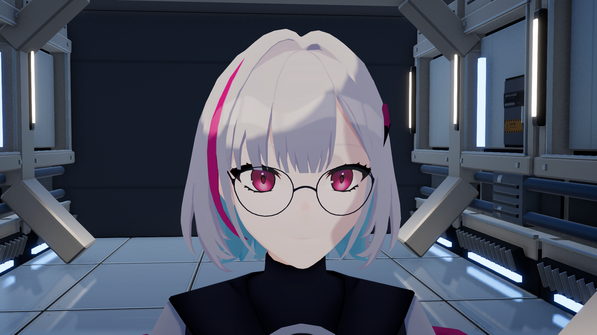

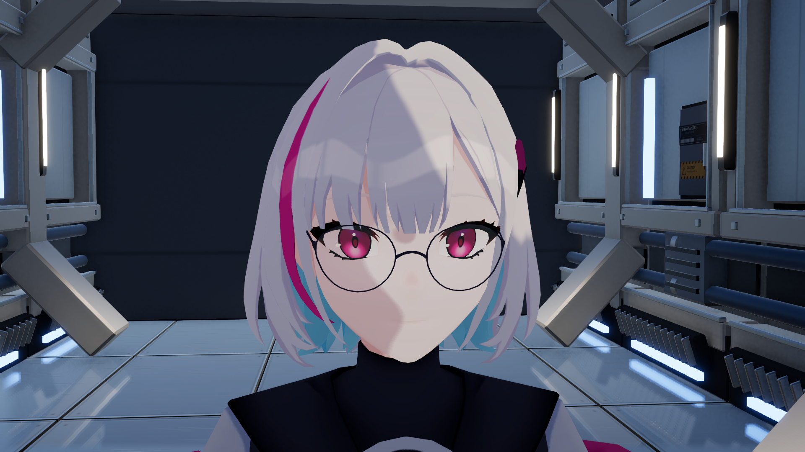

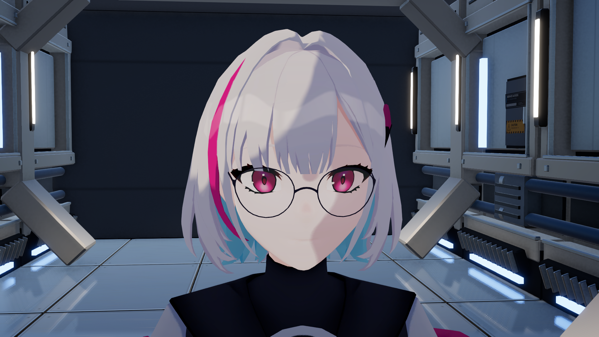

## 실내용 캐릭터 주광과 환경 그림자 분리

### 원인과 수정

기존 `KeyLight_AdjustRotation`의 방향은 `(0.329, 0.819, 0.470)`이다. 캐릭터 얼굴·가슴·다리에서 이 방향을 향해 조사하면 `BulkheadTop_2`와 `CeilingPanel_4/5`가 가로막고, 해당 Renderer의 ShadowCastingMode도 On이다. 옷의 Received Shadow 1 때문에 기존 `NdotL × shadowAttenuation`이 거의 0으로 내려가 한 단계 카툰의 그림자 면에 고정될 수 있었다.

이제 캐릭터 형태를 만드는 주광과 환경 그림자의 어두워짐을 분리한다.

- `Scripts/FuchsiaIndoorLighting.cs`: 씬의 `FuchsiaIndoorLightingVolume`에서 캐릭터 전용 가상 주광을 관리한다. 실제 Unity Light를 추가하지 않고 푸시아 Renderer 35개의 MaterialPropertyBlock으로 값만 전달한다. 배경 재질과 기존 30개 광원은 그대로다.
- 주광 방향은 **월드 기준**이며 카메라나 캐릭터를 따라 회전하지 않는다. 초기 회전 `(28,225,0)` / 빛을 향하는 방향 `(0.624,0.469,0.624)` / 색 `(1,0.94,0.90)` / 광량 0.28이다. Linear 프로젝트에서는 색을 선형으로 변환해 전달한다.
- 카툰 경계·얼굴 마스크·머리 광택은 이 가상 주광을 사용한다. 천장 그림자로 해당 방향이 사라지지 않는다. 원래 URP 주광의 그림자 맵은 별도로 읽어, 직접광 밝기만 제한적으로 낮춘다.
- 환경 그림자 강도는 0.18이다. Received Shadow 1인 옷은 완전히 가려져도 직접광을 최대 18%만 낮추고, 환경광 SampleSH는 유지한다. 얼굴·머리는 기존 Received Shadow 0.5가 추가로 적용되어 환경 그림자 감쇠가 최대 9%다. 기존 얼굴용 앞머리 깊이 그림자는 별도로 계속 작동한다.
- 불필요하게 캐릭터가 밝아지지 않도록 기존 Direct Light Ceiling, 보조광의 색·밝기 압축, 단일 카툰 그림자 경계는 유지한다. 렌즈의 광택도 같은 전용 주광을 받는다.

### 조정 방법과 적용 범위

Hierarchy의 **FuchsiaIndoorLightingVolume**을 선택해 Inspector에서 방향·색·광량·환경 그림자 강도를 조절한다. 가상 주광 오브젝트의 회전은 `_keyEulerAngles` 필드로 지정한다. 위치·크기는 조명 구역을 뜻한다.

- 구역 중심 `(0,1.5,6.5)`, 크기 `(6,4,24)m`, 바깥 전환 거리 2m. 기존 복도 이동 범위는 구역 내부다.
- 캐릭터 루트의 로컬 `(0,1,0)` 지점으로 구역을 판정한다. 박스 내부는 가중치 1, 밖에서는 SmoothStep으로 기존 씬 주광에 연결된다.
- 하나의 캐릭터 루트에 하나의 활성 조명 구역 컴포넌트를 사용하는 테스트 구성이다. 여러 겹친 구역 간 우선순위·혼합 관리자는 구현하지 않았다.
- 원본 FBX·보정 메시·공유 Material 자산의 조명 값은 복제하거나 덮어쓰지 않는다. 컴포넌트를 끄면 전용 주광 가중치를 0으로 복원한다. 다른 씬이나 원본 프리팹에서 가중치가 0이면 기존 URP 주광 계산을 사용한다.
- 성능을 위해 Renderer 참조는 캐시하고, 주광 값이나 구역 가중치가 바뀔 때만 PropertyBlock을 다시 기록한다. PropertyBlock 사용으로 캐릭터의 SRP Batcher 적용 범위가 달라질 수 있으며 대상 기기 성능은 측정하지 않았다.

### 확인 결과

- 같은 Main Camera 정면 전신 구도에서 전후 Play 렌더 비교. 기존 천장·프레임의 그림자 투영과 배경 PBR을 유지한 채 외투·다리의 밝은 면과 그림자 면을 확인했다.
- 캐릭터를 140도 회전해도 전달되는 주광 방향 `(0.624,0.469,0.624)`가 동일하다. 별도 45도 회전 화면에서 얼굴과 머리 음영을 확인하고 원래 자세로 복원했다.
- X=0/3/3.5/4/4.5/5m에서 구역 가중치 `1 / 1 / 0.84375 / 0.5 / 0.15625 / 0` 확인 후 원래 위치로 복원했다.
- 컴포넌트 비활성 시 주광 가중치 0, 재활성 시 1로 복원되는 것을 확인했다.
- Play에서 1초 이동 1.700m와 실내 가중치 1 유지, 카메라 구도 전환·초기화·바닥 평면 반사 확인.

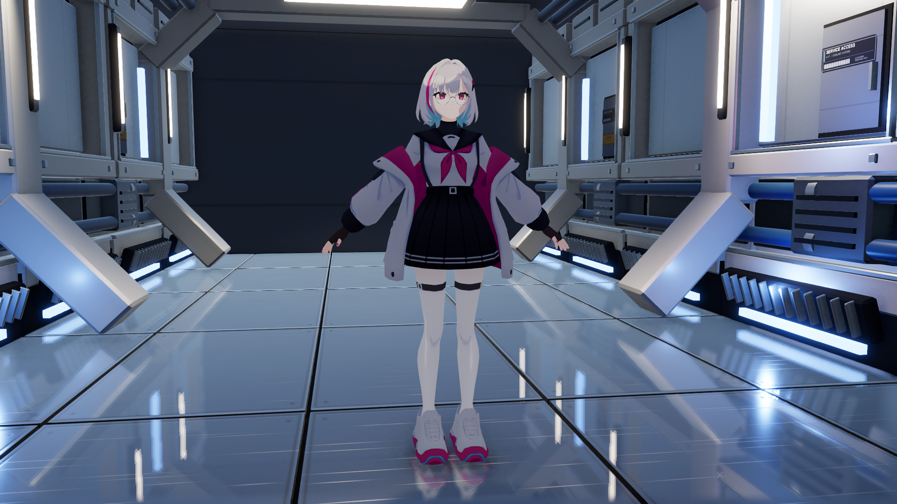

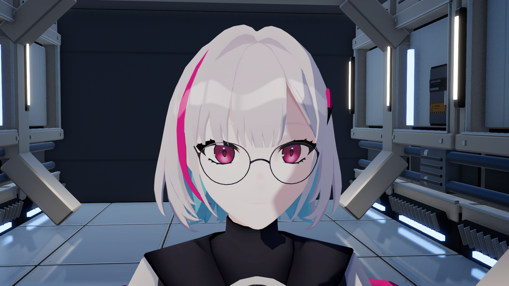

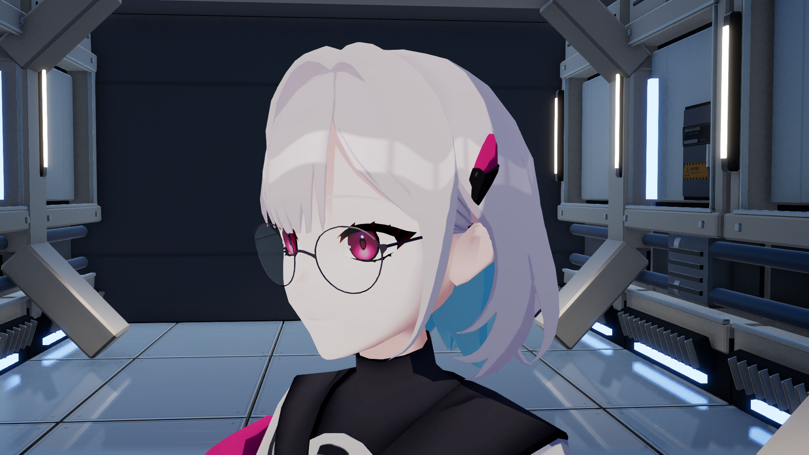

- 최종 재컴파일 후 신규 C# 오류 0, 관련 셰이더 6개의 메시지 0, 새 Play 실행의 Console 오류·경고 0건. 루트 참조를 비웠을 때 전용 주광 가중치가 0으로 해제되고 다시 연결하면 1로 복원되는 것도 확인했다.
- 편집 모드 복귀 후 씬 저장 완료. 얼굴 확대 구도와 FuchsiaIndoorLightingVolume 선택 상태로 남겼다.
- 전후 1920×1080 Play 이미지의 좌우 벽 영역을 비교한 결과 RGB 픽셀 차이 0. 배경 조명을 함께 밝히지 않고 캐릭터 표현만 변경된 것을 확인했다.

## 실내 추가 광원의 수광 반응 보강

기존 보조광 응답은 모든 불투명 부위에서 세기 0.16 / 밝기 상한 0.18 / 그림자 안 비율 0.35였다. 가상 주광 0.28에 비해 천장·벽·바닥의 실제 조명 반응이 약해 캐릭터가 환경에서 분리돼 보였다. Forward+ 추가 광원 루프 자체는 작동하고 있었다.

- 가상 주광 광량을 0.12로 낮췄다. 방향은 그대로 유지해 얼굴 마스크·앞머리 그림자·머리 광택과 한 단계 카툰 경계를 보존한다.
- 얼굴·눈은 실제 추가 광원 세기/상한 0.35/0.35, 나머지 불투명 부위는 0.65/0.55로 조정했다. 그림자 면의 추가 광원 비율은 0.8이다.
- 실제 조명도 카툰 그림자 색 안에서 계산한다. 주광과 보조광 합계의 휘도를 같은 RGB 비율로 제한한다. 합계 상한은 얼굴·눈 0.48, 머리 0.55, 옷·소품 0.60이다. Inspector의 기존 Direct Light Ceiling 표기는 Key + local light brightness ceiling으로 바뀌며 프로퍼티 ID와 연결은 유지한다.
- 추가 광원 계산의 최소 랩 성분을 0.25에서 0.10으로 낮춰 빛을 등진 면까지 균일하게 밝히는 현상을 줄였다. 실제 거리·각도·그림자 감쇠는 URP 값을 그대로 사용한다.
- 배경의 30개 광원·PBR 재질·노출 설정은 변경하지 않았다. 중앙에서 파란 바닥 조명이 은은한 것은 실제로 천장 Spot 14에 비해 Point 0.55이고 벽 쪽에 배치돼 있기 때문이다. 발광 표면의 모든 빛이 자동으로 동적 GI가 되는 것은 아니다.

### 수광 비교

동일 Main Camera의 Play 렌더에서 캐릭터의 추가광 세기만 0으로 바꾼 경우와 최종값을 비교했다. 1920×1080 캡처를 1000×562로 축소한 뒤 측정:

- 캐릭터 영역에서 RGB 차이 3 초과 픽셀 31,065개.
- 외투 표본 영역의 추가광 On−Off 평균 RGB 차이 (+28.79,+27.32,+24.32): 천장·벽의 따뜻한 빛 반영.
- 다리 표본 영역 (+2.71,+2.90,+3.81): 파란 보조광 반영.
- 좌우 벽 표본 영역의 픽셀 차이는 0. 캐릭터 수광만 비교한 검사다.
- 벽 방향으로 1.65m 이동해 가까운 팔·다리의 푸른빛 변화와 얼굴/앞머리 음영 유지 확인 후 편집 모드로 돌아갔다.

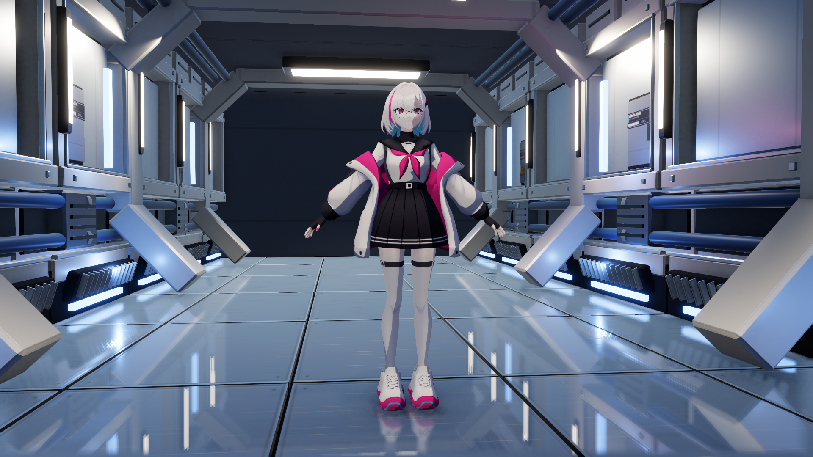

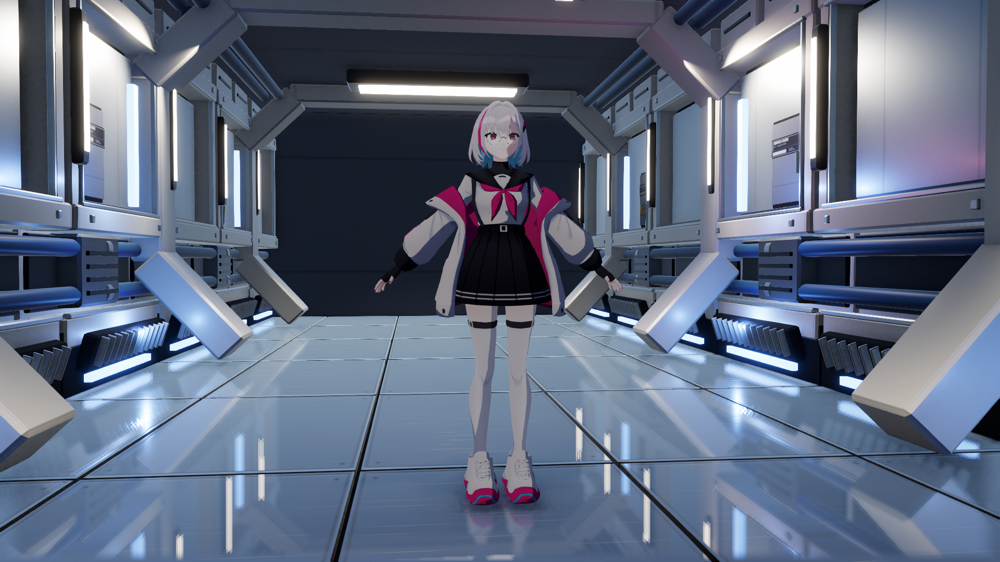

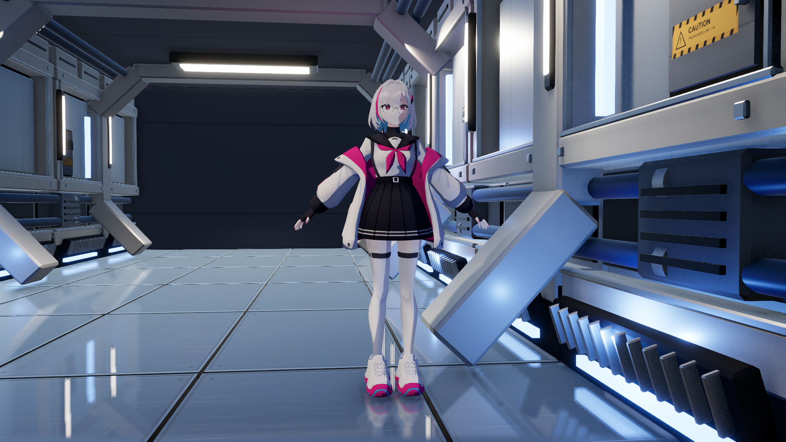

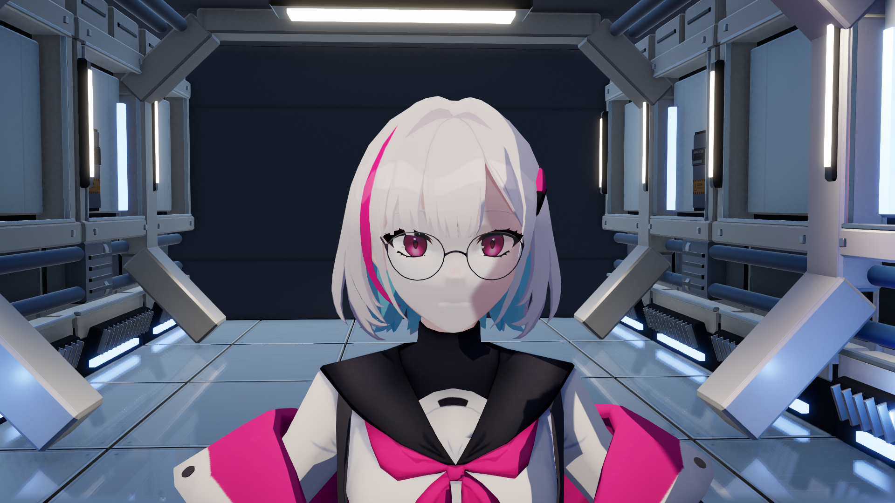

- 최종 C# 재컴파일 오류 0, 관련 셰이더 6종 ShaderUtil 메시지 0, 저장된 씬에서 새 Play 실행의 Console 오류 0 확인. 기존 UnityChan CS0436 중복 타입 경고 7건은 남아 있다.
- 현재 모델 위치에 맞춰 얼굴·정면 비교 카메라를 다시 맞췄다. 기본 얼굴 구도와 C키 전환 설정은 유지한다. 씬 저장 후 편집 모드로 복귀했다.
- Git 전체 diff 검사에는 Unity YAML 저장 시 빈 필드 뒤 공백과 기존 작업의 공백 항목이 표시된다. 셰이더 컴파일/Play 확인과 구분하며 전체 diff가 깨끗하다고 보고하지 않는다.
