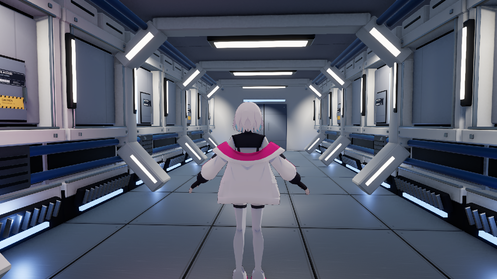
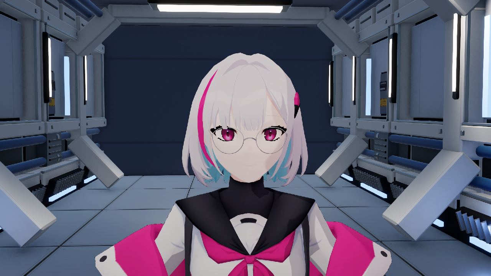
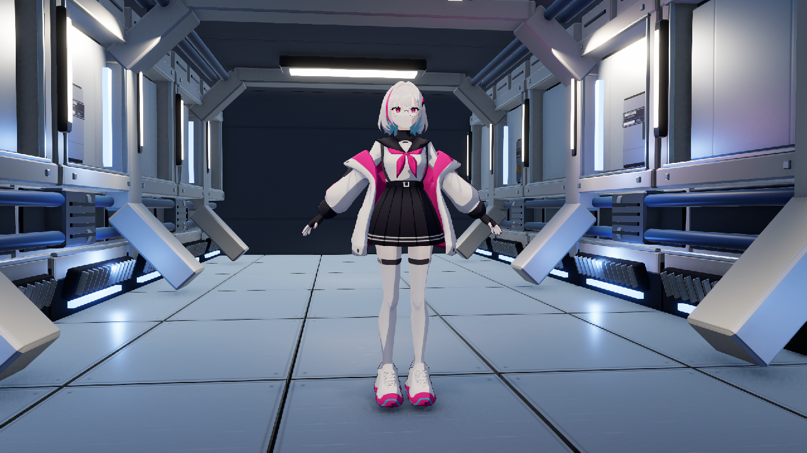
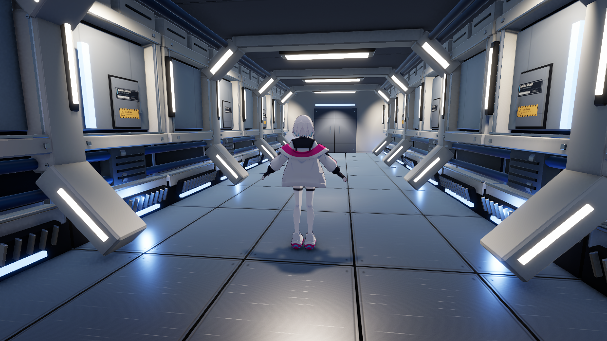
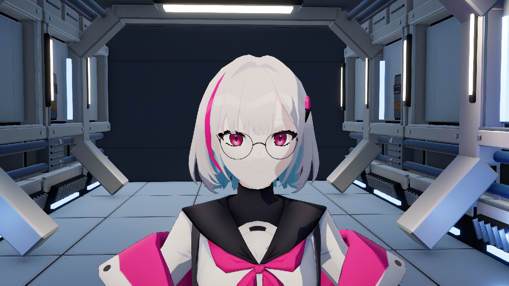
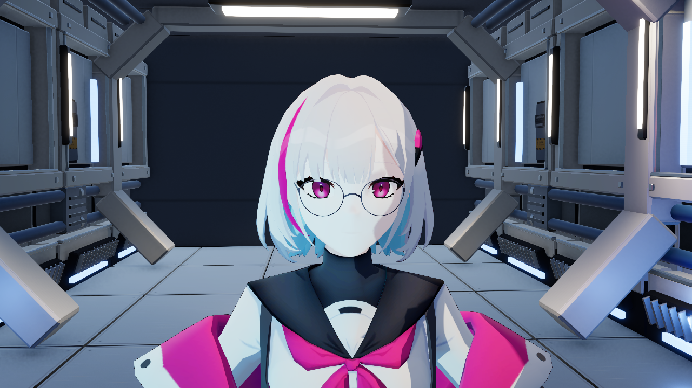

# 푸시아 캐릭터·배경 렌더링 테스트

브랜치 `feat/shader-development`, 씬 `Assets/CK_Semester_Project/Prototype/Scenes/FuchsiaShadowTest.unity`.
2026-10-23 기준으로 기존 실험용 셰이딩을 정리하고 캐릭터 NPR / 배경 PBR 구조로 재구성했다. 현재 조명 기준은 사용자가 마지막으로 첨부한 복도·전투 공간 가상 스크린샷이다.

## 레퍼런스 방향

- 라이팅: 가상 스크린샷의 회청색 실내 바탕, 따뜻한 천장 주광, 차가운 보조광을 기준으로 한다. 밝은 면적이 작은 조명 기구에만 몰리지 않도록 벽·천장 간접광을 높이고 바닥 반사는 절제한다.
- 캐릭터 셰이더: 젠존제·붕괴 스타레일의 큰 한 단계 명암, 얼굴 전용 음영, 덩어리로 정리한 머리 광택, 얇은 실루엣 선을 시각적 참고로 삼는다. 피부와 흰 옷의 고유색을 유지하면서 실제 실내 광원을 받게 한다.
- 배경 셰이더: 기존 URP PBR 구조를 유지한다. 캐릭터와 같은 툰 명암 단계를 배경에 적용하지 않는다.
- 이전의 차분한 후드 캐릭터 이미지는 과한 광택을 줄이는 참고였다. 현재 공간 전체를 어둡게 만드는 기준으로 사용하지 않는다.
- 실제 젠존제·스타레일 내부 셰이더를 복사한 구현은 아니다. 가상 스크린샷의 모델·포즈·텍스처·전용 마스크 품질까지 셰이더 하나로 재현했다고 보지 않는다.

기술 참고:

- [Unity의 Jack He 캐릭터 렌더링 발표](https://learning.unity3d.jp/570/): 주광·IBL·림, 얼굴과 모발 표현을 분리하는 참고. 2018년 붕괴3 자료이며 현재 젠존제·스타레일의 내부 구현을 설명하는 자료는 아니다.
- [Epic의 Kuro Games 인터뷰](https://www.unrealengine.com/developer-interviews/exploring-the-post-apocalyptic-charm-of-asg-open-worlds-in-wuthering-waves): 기본 조명, 색상·마스크의 그라데이션, 환경에 맞는 캐릭터 밝기, 색보정에 관한 제작진 설명.
- [StarRailNPRShader](https://github.com/stalomeow/StarRailNPRShader): 공식 소스가 아닌 팬 재현. 역할 분리만 참고했으며 코드는 이식하지 않았다.

## 현재 구성

팀 작업 루트: `Assets/CK_Semester_Project/Prototype/Sandbox/Junmo/FuchsiaShading/`.

| 대상 | 셰이더/역할 |
| --- | --- |
| 피부·눈·손 | `FuchsiaFaceToon.shader`: 얼굴 SDF/보정 노멀, 눈·손은 해당 기능 강도를 따로 제어 |
| 머리 | `FuchsiaHairToon.shader`: 보정 노멀과 제어맵을 쓰는 한 개의 띠 광택 |
| 옷·다리 | `FuchsiaClothToon.shader`: 한 단계 주광 명암, 환경광과 실제 추가 광원 |
| 금속·안경테 | `FuchsiaAccessoryToon.shader`: 작은 직접광 광택과 색광 림 |
| 안경알 | `FuchsiaLensToon.shader`: 낮은 불투명도와 가장자리 반사 |
| 복도 16개 재질 | `FuchsiaEnvironment.shader`, Shader 이름 `CK/Prototype/Fuchsia/Environment`: URP PBR |

### 캐릭터

- `FuchsiaLighting.hlsl`에서 URP 주광과 Forward+ 추가 광원을 계산한다. 주광이 명암 경계를 만들고 추가 광원은 색·밝기·얇은 림에 반영된다.
- `FuchsiaToonCommon.hlsl`에서 **주광과 보조광의 합산 밝기는 한 번만 제한**한다. 주광에는 전체 툰 명암을 적용하고 보조광에는 그 명암 색을 0.35 비율로만 적용한다. 따라서 주광 반대편에서도 실내 보조광의 색과 밝기가 남는다. 주변광은 직접광 그림자와 별도로 계산한다.
- `FuchsiaIndoorLightingVolume`의 월드 기준 주광으로 실내에서 천장 그림자에 얼굴이 전부 묻히는 것을 막는다. 광량 0.24, 회전 (28,225,0). 주광은 카메라나 캐릭터 회전을 따라가지 않는다. 구역 밖에서는 원래 씬 주광으로 혼합된다.
- 얼굴·손 Base Color는 (1,0.95,0.93), 나머지 부위는 흰색이다. 원본 푸시아의 분홍색 배색은 유지한다.
- 얼굴 보정 노멀 강도 0.65, SDF 오프셋 0.05, 경계 폭 0.018. 앞머리 깊이 그림자는 유지한다. 눈은 얼굴 마스크를 새로 받지 않는다. 얼굴 명암 강도는 0.65로 작은 형태가 과하게 어두워지는 것을 줄인다.
- 옷 명암 경계 폭은 0.016이다. 명암 강도는 코트 0.70, 머리 0.85, 눈 0.15, 나머지 1.0으로 구분한다.
- 직접광 강도는 얼굴 2.0, 눈 1.7, 코트 1.8, 머리 1.6, 나머지 1.3이다. 코트·머리의 그림자색은 (0.78,0.74,0.80)으로 올려 후면의 흰 재질이 짙은 회색으로 묻히는 것을 줄인다.
- 머리 광택 강도 0.16, 반폭 0.025, 경계 폭 0.008. 보정 띠와 중복되던 기존 이방성 계산은 제거했다.
- 주변광 강도는 얼굴 0.60, 나머지 0.55다. 실제 추가 광원 강도는 얼굴 0.60, 눈 0.50, 나머지 0.65이고 추가 광원 밝기 상한은 얼굴 0.35, 나머지 0.32다. 밝아진 배경 간접광이 캐릭터를 하얗게 밀어 올리지 않도록 별도로 제어한다.
- `_RimStrength`, `_RimPower`는 실제 주광·추가 광원의 방향·거리·가림을 따르는 작은 반사광을 제어한다. 강도는 얼굴·눈 0, 금속 0.06, 머리 0.05, 옷 등 0.03이며 고정 발광 테두리가 아니다.
- 얼굴·눈이 공유하는 원본 텍스처는 RGB24 / Trilinear / Mipmap 유지다. 원본 PSD 픽셀은 수정하지 않았다. 원래 입·코 텍스처가 연한 한계는 남아 있다.

### 외곽선

- `FuchsiaOutlineFeature.cs`와 `FuchsiaOutline.hlsl`은 캐릭터 custom pass만 렌더한다. 기본 Renderer 0은 건드리지 않고 테스트 Renderer 1에서 사용한다.
- 화면 픽셀 폭으로 계산: 옷 0.65px, 머리 0.6px, 금속 0.5px, 얼굴 0.3px, 눈·다리 0px. 다리는 게임 거리에서 선이 점처럼 끊겨 보여 외곽선 대신 명암으로 읽히게 했다.
- Forward 패스가 URP 사용자 stencil bit 0에 가시 캐릭터 영역을 기록한다. 외곽선은 그 영역 바깥에만 그려 열린 머리 메시의 내부 점선이 새지 않게 한다.
- opaque 깊이 검사로 벽 뒤 선을 가린다. 배경에는 선을 그리지 않는다. 기존 ShadowCaster / Depth / DepthNormals / MotionVectors / HairDepth 패스는 유지했다.
- Forward+ Windows Editor에서 검증했다. stencil 있는 깊이 버퍼가 필요하며 XR·Compatibility Mode·모바일 비용은 검증하지 않았다.

### 배경

- URP Lit/Complex Lit의 Base / Metallic+Smoothness / Normal / AO / Emission / Clear Coat / Detail 맵 연결을 유지했다.
- `_SmoothnessLimit`: 바닥 0.56, 도장 0.46, 노출 금속 0.70, 고무 0.22. 마스크 맵을 읽은 최종 광택의 상한이다.
- `_DetailStrength` 0.20, 바닥 Normal 0.25, 프레임 Normal 0.20. 색·재질의 큰 덩어리를 읽기 쉽게 미세 디테일을 억제했다.
- `_IndirectTint` (0.98,0.99,1), `_IndirectStrength`는 바닥 0.90, 나머지 1.20. 실제 광원·그림자·반사 프로브·SSAO를 유지한다.
- 바닥 Base Color는 (0.69,0.70,0.72), 벽 안쪽 패널은 (0.72,0.74,0.78)이다. 바닥을 통째로 밝히기보다 어두웠던 벽 면을 보강한다. 램프 발광 배율은 0.65다.
- Metallic 맵이 활성화된 재질은 맵 R을 사용한다. 도장 벽의 R 평균은 약 0.0007, 문·고무는 0, 벽 안쪽 패널은 약 0.58, 바닥은 약 0.935, 노출 프레임은 약 0.961이다. Inspector의 `_Metallic=1`만 보고 도장 전체가 금속이라고 판단하지 않는다.
- 배경 셰이더 코드의 조명 모델은 이번 라이팅 조정에서 바꾸지 않았다. 바닥에 캐릭터가 정확히 비치는 실시간 거울 반사는 없고 `CorridorReflectionProbe`의 PBR 환경 반사가 남는다. 조명·재질 변경 후에는 프로브를 다시 베이크한다.

### 가상 스크린샷 라이팅

| 항목 | 현재 설정 |
| --- | --- |
| Trilight Sky / Equator / Ground | (0.58,0.61,0.69) / (0.46,0.49,0.57) / (0.27,0.30,0.37) |
| 천장 Spot | 강도 14, 색 (1,0.95,0.90) |
| 벽 Wall Wash | 강도 7, 색 (1,0.95,0.90) |
| 바닥 Blue Fill | 강도 0.35, 색 (0.46,0.65,1), 범위 3.8m |
| 좌우 Cool Fill | 강도 0.75, 색 (0.72,0.82,1), 범위 5.5m, 높이 1.55m / Z 2.2m |
| 캐릭터 Accent | 강도 0.8, 색 (1,0.62,0.78), 범위 3.8m, 위치 (-1.35,1.8,4.18) |
| 후처리 | Post Exposure +0.35, Contrast 4, Bloom 0.20 |

천장 주광과 푸른 보조광을 구분하되 벽의 그늘에도 회청색 환경광이 남게 한다. 캐릭터의 명암 방향은 월드 기준 전용 주광이 결정하고, 실제 실내 광원은 색과 밝기를 보탠다.

## 제거한 구성

- 미사용 2단계 그림자 `_DeepShadeColor`, `_DeepShadeStep`.
- 꺼진 불투명 캐릭터 Emission 경로와 직렬화 잔여 값. 배경 조명용 발광은 유지한다.
- 중복 직접광 밝기 제한, 보정 헤어 광택과 겹치던 이방성 계산.
- `PolishedFloorReflection` 오브젝트, `CorridorPlanarReflection.cs`, `CorridorFloorReflection.shader`, 해당 전용 머티리얼과 meta.
- 이전 설정을 덮어쓰던 `ApplyFuchsiaKeyFill.cs`, `ApplyCorridorLighting.cs`. 현재 재현 도구는 아래 한 개다.
- 머티리얼의 현재 셰이더에 없는 잔여 프로퍼티 276개를 정리했다.

작업 전 소스·재질·씬 스냅샷은 로컬 `output/ShaderRebuild20261023/Before/`에 보관했다. Git에는 추가하지 않는다.

## 사용/재현

- 기본 구도는 가상 스크린샷을 비교하기 위한 후면 구도(`_initialCameraView=1`)다. `C`: 정면 전신 → 얼굴 확대 → 넓은 후면 게임 구도 → 기본 후면 구도 순환.
- 기본 후면 카메라는 캐릭터 bounds 중심에서 (0.15,0.60,-2.45)m 떨어지고, 중심보다 0.48m 위를 바라본다. FOV는 50이다.
- `WASD`/방향키 이동, `Shift` 빠르게 이동, `R` 위치 초기화.
- 캐릭터 조명: `FuchsiaIndoorLightingVolume`.
- 캐릭터 재질: `Materials/Fuchsia*Toon.mat`의 명암·광택·림·외곽선.
- 배경 재질: `Materials/Corridor/`의 거칠기 상한·노멀·간접광.
- 재현: Edit 모드에서 `Docs/Tools/ApplyFuchsiaRenderStyle.cs`를 Unity CLI `eval_file`로 실행한다. 기존 메시 생성이 필요하면 `ApplyFuchsiaStyleMeshes.cs`와 `ApplyCorridorArchitecture.cs`를 먼저 사용한다.
- 외곽선·앞머리·SSAO는 `Data/FuchsiaTestRenderer.asset`에서 관리한다. Renderer 1 연결을 유지한다.

## 현재 비교 이미지

## 이전 재구성 시 검증 기록

아래 수치와 이미지는 현재 가상 스크린샷 라이팅 조정 **이전**의 셰이더 재구성 검증이다. 새 조명에서 다시 측정한 수치로 해석하지 않는다.

- 외곽선 On/Off: 1280×720에서 차이 3 초과 픽셀 2,012개. 좌우 배경 표본 픽셀 차이 0, 내부 머리 표본에서 잘못 그려지는 선 0개.
- 임시 가림 큐브 뒤의 표본에서 외곽선 On/Off RGB 최대 차이 0. 깊이 가림 확인 후 임시 물체를 제거했다.
- 임시 청록 Point Light에서 얼굴·옷·머리가 색을 받는 것을 확인했다. 테스트 광원은 저장하지 않았다.
- 실제 프레임 진행을 `Time.frameCount changed`로 확인했다. 스크린 캡처는 셰이더 비동기 컴파일이 끝난 뒤 확인한다.

### 이전 재구성 결과

- 새 Play 세션에서 1초 이동 1.7002m, 초기화 위치 오차 0, 카메라 4회 순환 후 복원 오차 0 확인.
- 관련 셰이더 6종 메시지 0개. 최종 Play 구간 새 Console 오류 0건. C# 재컴파일 때의 기존 UnityChan 중복 타입 경고 7건은 별개로 남아 있다.
- 씬 내 누락 스크립트 0개, 삭제한 반사 자산 GUID의 Assets 내 참조 0개, 새 자산 meta 누락 0개.
- 실제 씬 Light 30개, 검증용 광원·가림 큐브 0개, 평면 반사 오브젝트 0개.
- Renderer 1의 SSAO / 앞머리 깊이 / 외곽선 3개 기능 활성. 기본 Renderer 0은 유지한다.
- 배경 16개 재질 적용 및 Reflection Probe 베이크 성공. 소스 코드 공백 검사 통과.
- 당시에는 정면 전신 구도로 저장했다. 현재 기본 구도는 위의 후면 비교 카메라로 변경했다.

## 가상 스크린샷 라이팅 최종 검증

- 현재 프리셋의 기준 파일은 `Docs/Tools/ApplyFuchsiaRenderStyle.cs`다. 캐릭터 14개·복도 16개 재질과 실제 광원 30개에 적용했다.
- 관련 셰이더 6종 컴파일 메시지 0개, 이번 Play 구간의 새 Console 오류 0건. 실제 프레임 진행을 확인하고 후처리가 포함된 Game View를 캡처했다.
- 실제 보조광 29개를 Play 중에만 껐다 켜서 비교했다. 동일 후면 코트 표본(1280×720 화면의 X 590~679, Y 425~494)에서 보조광 On의 평균 RGB는 Off보다 (7.85,8.28,11.51) 높았다. 얼굴 표본에서도 약 13~14/255의 밝기 반응을 확인했다. 모든 광원을 복원했다.
- 최종 조명·재질로 256 해상도 Reflection Probe 베이크 성공. 후면 기본 구도로 씬을 저장했다.
- 기존 이동·외곽선 구조는 유지했다. 이번 변경에서 이동 기능이나 다른 플랫폼 성능을 다시 측정하지 않았다.
- 실제 모델은 정적인 A 포즈이고 복도는 프로토타입 형상이다. 레퍼런스의 헤어·옷 주름·비대칭 구조·상세 텍스처까지 일치하는 결과는 아니다.
