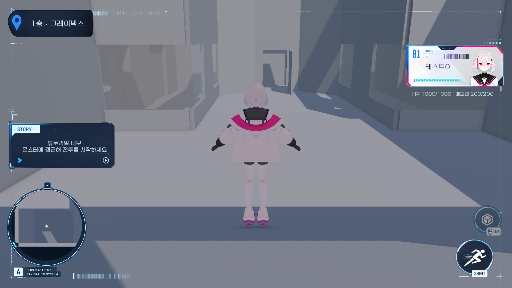
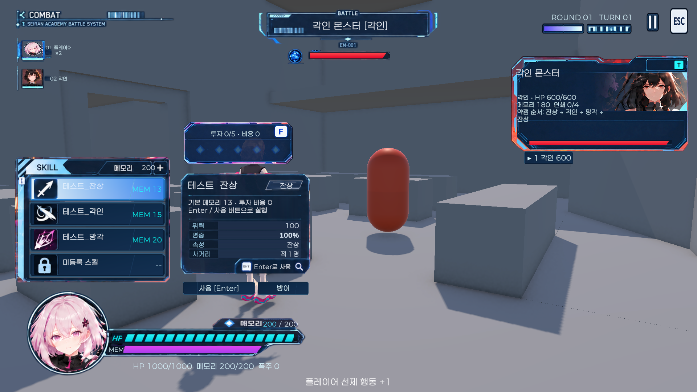

# 기존 UI 에셋 정리

실행 씬은 `Assets/CK_Semester_Project/Prototype/Scenes/TutorialGrayboxingDemo.unity`다. `prototype-ui`의 프레임, 초상화, 스킬 아이콘, 선택/일반 버튼, HP·메모리 게이지 에셋을 재사용한다. 원본 TutorialDemo 씬과 PNG는 보존했다. 새 사각 패널 HUD는 사용하지 않는다.

## 수정 범위

- 기존 Canvas와 UI 오브젝트를 유지하고 주요 패널을 화면 모서리/상단/하단 앵커에 배치했다. CanvasScaler는 1920×1080 기준 Expand 모드다.
- 샘플 이름·수치·가짜 지도·고정 슬롯이 박힌 에셋은 원래 디자인을 기준으로 빈 데이터 영역을 가진 파생 PNG로 편집했다. 원본은 교체하지 않는다.
- 검은 Backdrop과 덮개 생성 코드를 제거했다. 텍스트와 Slider는 에셋의 빈 영역에 표시한다.
- 카드 이름·HP, 층 배너, 투자 비용, 스킬 비용, 적 정보, 메모리 숫자 위치를 정리했다. 실제 Slider와 별도 트랙이 어긋나지 않게 함께 배치한다.
- 행동 순서의 기존 초상화와 강조 프레임을 다시 표시하고, 스킬·방어·대상 버튼에도 기존 버튼 에셋을 사용한다.
- 미니맵을 원형으로 클리핑하고 256×256 텍스처를 재사용한다. 필드에서 최대 10Hz 렌더링, 전투에서 정지한다.
- 편집 PNG의 Unity 임포트는 최대 1024px, mipmap 끔, read/write 끔, 압축 사용이다. PNG 자체를 자르지 않고 투명 여백을 제외한 Sprite rect를 설정했다.

## 데모에서 제거한 조작 UI

- 1층/2층 이동 버튼과 Presenter의 생성·이벤트 참조를 제거했다. 현재 층을 읽어 위치와 배너에 표시하는 연결은 유지한다. 기본 FloorTravelButtons 디버그 UI는 기존처럼 숨겨져 있다.
- 동작이 연결되지 않은 필드 C/J/ESC 메뉴, TAB/R 패널, E 상호작용 아이콘을 Commands 그룹과 함께 제거했다. SHIFT는 아래 달리기 기능에 연결해 복원했다.
- 미니맵은 실제 카메라 표시만 남기고 미연결 Button 컴포넌트를 제거했다.
- 미등록 네 번째 스킬 버튼과 미구현 상세 화면 버튼 오브젝트를 제거했다. 등록된 세 스킬, 투자, 방어, 대상 선택, 전투 종료 버튼은 유지한다.
- 원본 TutorialDemo 씬과 UI 에셋은 그대로 보존했다. 재생성 및 반복 정리에서도 제거 상태를 유지한다.

HUD PlayMode 통합 테스트 7개 통과, 컴파일 오류 0건. 16:9 필드 Game View 캡처에서 삭제 상태와 실제 미니맵·수치 표시를 확인했다.

## 구역 배너와 필드 조작

- 시작 배너는 2.5초 표시하고 1.2초 동안 CanvasGroup alpha를 낮춘 뒤 비활성화한다. 전투에서 필드로 복귀해도 시작 배너는 재표시하지 않는다.
- SHIFT를 누르며 WASD 이동하면 1.8배로 달린다. 기존 달리기 UI 클릭은 달리기 모드를 켜고 끈다. 실제 달리기/토글 상태를 청록색으로 표시하며, 전투 진입 등 이동 비활성화 시 초기화한다.
- 기존 E 버튼을 LMB 버튼으로 바꿔 우측 하단 달리기 버튼 위에 배치했다. 키보드 E는 사용하지 않는다. 기존 좌클릭 선제 전투와 UI가 같은 거리(2.5m)·시야·쿨다운 조건을 사용한다. 주변 대상이 없으면 UI가 비활성화된다.
- 기존 E PNG를 built-in imagegen으로 편집한 파생 파일 `Refined/ui_field_attack_lmb_btn.png`를 사용한다. 원본 PNG와 SHIFT 에셋은 보존했다.
- 7개 PlayMode 테스트로 기존 HUD 연결, 배너 페이드, 달리기 실제 이동 거리와 상태 초기화, 좌클릭 UI 전투 진입을 확인했다. Game View에서 페이드 후 화면 배치를 확인했다.

## 데이터와 도구

게임 규칙과 비용은 기존 TutorialBattleController/BattleSession을 사용한다. PrototypeHudPresenter는 표시와 선택을 담당한다. HP·메모리·현재 층 표시·투자·스킬 비용·대상·행동 순서 데이터 연동을 유지했다. 미구현 상세 화면과 메뉴 기능은 추가하지 않았다.

씬 수정·저장·Play 검증은 Unity MCP로 수행했다. 별도 CK 연결 메뉴는 추가하지 않았다. 기존 Build 단계의 UI 연결 코드에는 동일한 수정 로직을 반영해 재생성 시 덮개가 다시 생기지 않게 했다.

에셋 편집은 built-in imagegen을 사용했다. 파생 에셋과 편집 프롬프트는 [UiAssetEditPrompts.md](UiAssetEditPrompts.md)에 기록했다.

## 검증

Unity 6000.3.23f1에서 HUD PlayMode 테스트 5개가 모두 통과했다: 필드 수치·현재 층 표시와 미구현 조작 제거, 스킬 선택/투자/실행과 비용·피해, 메모리 부족 잠금, 기존 스킬 패널 및 덮개 부재/16:9·4:3·21:9 주요 패널 경계, 미니맵 횟수 제한과 전투 중 정지. 키 힌트의 미지원 글리프를 ENT로 바꾼 뒤 컴파일 및 실제 표시를 확인했다.

실제 Game View에서 16:9 필드·전투와 4:3 필드 캡처로 데이터 표시·슬라이더 위치·패널 겹침을 확인했다. Play 종료/리로드 과정에서 기존 몬스터 NavMesh 정리 오류가 관찰되었으며, 전투 통합 테스트는 통과했다. 전체 튜토리얼 완주와 플레이어 빌드, FPS/GPU 프레임 시간 측정은 수행하지 않았다.

## 그레이박스 콘텐츠 연결

기존 STORY 패널의 단계별 목표와 문/엘리베이터 좌클릭 상호작용을 연결했다. 실제 층 높이를 기준으로 구역을 표시하며 기존 LMB 버튼도 문·패널을 우선 실행한다. 목표/피드백 패널은 기존 스킬 버튼 PNG를 재사용한다. 현재 기능과 Inspector 위치, PlayMode 테스트 11개 결과는 [TutorialLevelContent.md](TutorialLevelContent.md)를 참조한다.

## 적 클릭 후 전투 조작 UI

전투 진입 시 기본 HUD(행동 순서, 적 이름/HP, 턴, 플레이어 HP/메모리)만 표시한다. 월드의 살아 있는 전투 적을 좌클릭하거나 1~3 대상 키로 선택하면 기존 `PlayerTurnUI`의 스킬 목록·투자·스킬 설명·적 카드·실행/방어가 표시된다. 새 전투와 전투 종료 시 사용자 타깃 선택 상태를 초기화한다. 조작 UI가 열리기 전에는 Presenter의 F/Enter 조작을 실행하지 않는다.

적 카드에 구워져 있던 샘플 캐릭터를 built-in imagegen으로 제거한 `Refined/ui_enemycard_no_portrait_panel.png`를 사용한다. 기존 카드 프레임과 색상은 유지하며 원본 PNG는 보존한다. 등록된 몬스터 일러스트가 없으므로 몬스터 행동 순서 슬롯의 샘플 초상화도 숨긴다.

이번 변경은 적 화면 좌표 클릭·빈 공간 클릭·재진입 초기화와 스킬 비용/실행·투자 잠금 기능만 집중 검증한다. 사용자 요청에 따라 화면 비율 테스트는 실행하지 않는다.

## 2026-10-16 전투 스킬 UI 시안 반영

기존 Canvas와 버튼·스킬 아이콘·설명창·메모리 다이아몬드·HP 바 에셋을 유지하며 중앙 왼쪽 곡선형 메뉴로 재배치했다. 등록된 스킬 3개를 그대로 사용하며 시안의 반복된 샘플 스킬/적 초상화는 추가하지 않는다. 곡선 연결선만 BattleSkillArcGraphic의 uGUI 메시로 그리며 전체 화면 이미지를 사용하지 않는다.

- 적을 클릭하면 기존처럼 명령 UI가 열린다. 이때 스킬 설명은 숨겨 둔다.
- 스킬 클릭 또는 ↑/↓로 선택을 바꾸면 해당 스킬 설명을 연다. 끝에서 반대편으로 순환한다. 선택만으로 행동/비용을 확정하지 않는다.
- Enter/숫자 패드 Enter는 현재 강조된 스킬을 기존처럼 바로 사용한다. 선택/확정을 위한 추가 Enter 단계는 만들지 않았다.
- F와 메모리 투자 클릭, 스킬 사용 버튼, 방어 및 대상 선택·메모리 부족 판정은 유지한다.
- 행동 연출/적 턴 및 새 전투에서는 설명을 다시 숨긴다. 타깃을 선택하기 전이나 행동 불가 상태에는 방향키로 스킬을 바꾸지 않는다.
- HUD의 키 입력을 EventSystem Submit보다 먼저 처리하여 Enter가 중복 실행되지 않게 한다.

기존 PrototypeUiIntegration.RefineCurrentScene이 마지막에 BattleSkillLayoutIntegration.ApplyCurrentScene을 호출하므로 재정리 후에도 새 배치를 유지한다. `_skillDetailsPanel` 직렬화 참조를 추가했으며 미연결된 기존 HUD는 Awake에서 기존 스킬 이름 텍스트의 부모 패널을 사용한다. 전투 데이터/피해/비용/강화 규칙은 변경하지 않는다.

화면 비율 테스트는 기존 요청에 따라 실행하지 않는다.

검증: BattleSkillMenu 카테고리 PlayMode 테스트 5개 통과(선택·순환·설명 초기화·기존 Enter 실행·메모리 비용·투자 잠금·대상 선택). GameView에 실제 DownArrow 입력을 전달해 선택 인덱스 0→1과 설명 표시를 확인했다. 단일 해상도의 실제 화면에서 선택 전/후 배치를 확인했으며 화면 비율별 테스트는 실행하지 않았다.

2026-10-16 후속 수정: 메모리 투자 패널의 알파 0.01을 1로 복구하고 기존 프레임 안에 5개 슬롯·투자 단계·비용을 배치했다. 빈 슬롯 알파를 0.65로 높이고 현재/최대 메모리 표시를 확대했다. SkillPanel 앵커 x를 0.39에서 0.46으로 옮기고 설명·사용·방어도 같은 거리만큼 이동했다(1920 기준 약 134px). 실제 전투 화면에서 2/5 투자 점등 및 메모리 표시를 확인했고 기존 패널 버튼 이벤트 실행으로 2→3 단계 변경을 확인했다. 화면 비율 테스트는 실행하지 않았다.

## 2026-10-16 푸시아 스킬 VFX 연결

사용자 제공 SakuraSlash_VFX.unitypackage와 Charging_VFX.unitypackage를 Unity MCP의 AssetDatabase API로 가져왔다. 원본은 Graphics/Effects 아래에 보관하고 실제 전투용 프리팹은 Prefabs/Effects에 분리했다.

- 1번 스킬: FuchsiaSkill01SakuraSlash. SakuraSlash Shader Graph와 SakuraSlashFade, 벚꽃 파티클을 사용한다. 원본 머티리얼의 누락된 _SlashTex 참조는 제공된 New_slash_effect_texture를 연결한 별도 FuchsiaSakuraSlash 머티리얼로 보정했다.
- 2번 스킬: FuchsiaSkill02Charging. PinkCharge 원본에서 파생한 전투용 프리팹이다. 패키지의 분홍/보라 머티리얼과 SG_RisingAuraUpward로 생성한 FuchsiaRisingAura를 사용한다. 머티리얼이 없던 비표시용 루트/조명 파티클의 Renderer는 숨기되 조명 모듈은 유지한다.
- BasicSkillEnhancement.asset의 SK00/SK03/SK06과 SK01/SK04/SK07에 각각 연결했다. 3번 스킬은 변경하지 않는다.
- 기존 TutorialBattleActionPresentation의 타격 시점(행동 진행률 0.35)에 대상 위치에서 생성하고 행동 종료/취소 시 정리한다. 1.2초 행동 시간 안에 맞도록 벚꽃 파티클 속도는 2배, 차징은 3.3배로 설정했다.
- 콘티용 애니메이션 클립이 없다는 사용자 지시에 따라 이펙트만 먼저 적용했다. 베기/X자 베기 모션이나 콘티의 추가 연타·투사체 시퀀스는 구현하지 않았다. 기존 이동·복귀·Idle과 전투 계산은 유지한다.

검증: 실제 스킬 SK00/SK01 사용 결과를 기존 연출의 타격 구간에서 샘플링해 GameView를 캡처했다. 두 이펙트의 표시, 누락 머티리얼/텍스처 보정, 1~3단계 연결 6개 및 종료/취소 후 이펙트 제거를 확인했다. 화면 비율 테스트는 실행하지 않았다.

### 후속: 차징 해제 및 검기·타격 배치 보정

2번 스킬(SK01/SK04/SK07)의 차징 연결을 모두 해제했다. 원본 패키지와 전투용 차징 프리팹은 재사용을 위해 보존한다.

1번 베기 프리팹에 TutorialSlashVfxPlacement와 패키지의 SakuraHitDetails를 연결했다. 첨부 회전값(좌 -63.493/197.69/-9.382, 우 61.358/1.604/-8.73)과 크기 6을 적용한다. 회전은 현재 카메라 기준이며 현재 기본값은 오른쪽 베기다. Is Left Slash를 바꾸면 검기와 HitSparksFast가 함께 방향을 바꾼다. HitSparksFast의 원본 파티클 축 보정은 유지한다. 나머지 HitFlashCore/Glow, HitRays, HitSparksSmall/Backscatter는 적 기준 회전을 유지한다.

Surface Padding 기본값은 0.6m다(사진에서 추정한 초기값). 적 몸체 Bounds에서 플레이어 쪽 표면 바깥으로 이 간격만큼 띄우고, 카메라에서 타격 중심이 적 내부에 묻히는 경우에는 카메라 쪽 표면 앞으로 추가 보정한다. 벽을 뚫어 그리는 셰이더 변경은 하지 않았다. 설정은 Prefabs/Effects/FuchsiaSkill01SakuraSlash.prefab의 TutorialSlashVfxPlacement Inspector에서 조절할 수 있다.

실제 전투 결과로 표시 위치를 캡처하고 양쪽 방향을 확인했다. 방향 전환 시 Fast Sparks 회전 차이는 약 172.59도, 나머지 타격 그룹 회전 차이는 0도였다. 크기 (6,6,6), Fast Sparks 방출, 차징 3단계 연결 해제, 전투 취소 후 잔여 효과 없음 및 Console 오류 없음도 확인했다. 애니메이션·추가 연타는 변경하지 않았다.

좌우 랜덤 후속: TutorialSlashVfxPlacement.Initialize에서 공격마다 좌/우를 각각 50% 확률로 한 번 선택한다. 별도 System.Random을 사용해 Unity 파티클/게임플레이 난수 상태를 소비하지 않는다. 선택한 방향은 해당 공격이 끝날 때까지 유지하며 HitSparksFast에도 함께 적용된다. Is Left Slash는 이제 고정 설정이 아니라 현재 공격에서 선택된 방향을 표시한다.

### 후속: 베기 전체 파티클 및 캐릭터 공격 전 차징

베기는 FuchsiaSkill01SakuraSlash 프리팹 전체를 생성하고, 벚꽃·HitFlash·HitRays·HitSparks 등 활성 파티클 시스템 30개를 각각 한 번씩 재생한다. 기존 좌우 랜덤·Fast Sparks 방향·적 앞 배치는 유지한다.

차징은 적 타격 슬롯과 분리한 SkillStages._chargeEffect 슬롯에 연결했다. 스킬 순서대로 잔상=빨강(FuchsiaChargeRed), 각인=보라(FuchsiaChargePurple), 망각=파랑(FuchsiaChargeBlue)이며 각 기본 스킬의 강화 1~3단계 ID도 같은 차징을 사용한다. 기존 ChargingVFX의 색상별 머티리얼·라이트와 Aura 셰이더를 사용한 전용 프리팹/머티리얼을 생성했다. 원본은 보존한다.

BasicSkillEnhancement의 Charge Fraction=0.25로 기존 1.2초 행동 중 처음 약 0.3초는 캐릭터 자리에서 차징한다. 차징은 캐릭터 자식으로 발밑에 생성하고, 끝나는 즉시 숨겨 제거한 뒤 나머지 시간에 기존 접근·베기·복귀를 진행한다. 차징 프리팹의 파티클 속도는 7.5배로 이 시간 안에 맞췄다. 차징 없는 스킬은 기존 시간 배분을 사용한다. 애니메이션/피해/메모리 계산은 변경하지 않는다.

실제 SK00/SK01/SK02 사용 결과에서 빨강·보라·파랑을 각각 캡처했다. 차징 중 캐릭터 원위치 유지, 캐릭터 로컬 위치 (0,0,0), 타격 이펙트 미생성, 공격 시 차징 숨김, 베기 파티클 30/30 재생(샘플 시 입자 48개), 강화 ID 9개 연결, 전투 취소 후 차징 잔여 없음 등을 확인했다. 캡처는 Temp/ChargeRedCheck.png, ChargePurpleCheck.png, ChargeBlueCheck.png, FullSakuraParticlesCheck.png에 둔다. 화면 비율 테스트는 실행하지 않았다.

후속 검증: BattleSkillMenu PlayMode 테스트 5개 모두 통과(선택/실행/투자/대상 선택, 약 13.1초).

차징 속도 후속: BasicSkillEnhancement.asset의 Charge Playback Speed를 0.5로 설정했다. 색상별 프리팹의 기본 Main/Simulation Speed 7.5에 곱해져 실제 생성된 차징은 3.75로 재생된다. 차징 구간은 0.3→0.6초로 늘리고 접근·베기·복귀 시간은 기존 0.9초로 유지해 전체 플레이어 스킬 연출은 1.2→1.5초가 된다. 차징 없는 행동/몬스터 행동 시간은 유지한다. 이 설정은 세 색상/강화 단계에 공통이며 1이면 기존 속도, 0.5면 절반 속도다.

차징 속도 검증: Play 모드에서 세 프리팹의 모든 파티클이 실제 속도 3.75로 재생됨을 확인했다. 계산상 차징 0.6초/이후 공격 0.9초를 확인했다. HUD 테스트는 최초 4/5 통과했고 피해 검사 1개가 무작위 빗나감으로 실패했다. 동일 실패 항목 재실행은 통과했다(테스트/전투 규칙 수정 없음).

### 2026-10-16 컨펌 영상 비교 후 보정

제공 영상의 프레임을 비교했다. 차징 영상의 두 번째 완전한 재생은 약 2.70~3.93초(보이는 효과 약 1.23초)다. 기존 0.6초 차징은 빨랐다. Charge Playback Speed를 0.25로 바꿔 차징 대기 1.2초/실제 파티클 Simulation Speed 1.875로 맞췄다. 이후 접근·베기·복귀 0.9초는 유지하며 전체 플레이어 스킬 연출은 약 2.1초다.

슬래시에는 조명 외의 차이도 있었다. 가로 타격선 ImpactStreak가 전투용 프리팹에서 누락되어 있었다. 해당 Shader Graph와 제공 SakuraImpactStreakPlayer를 연결한 콜라이더 없는 전용 Quad를 추가했다. 검기 시작 0.17초 뒤 타격선이 켜지고 0.3초 커브로 사라진다. 전투용 FuchsiaImpactStreak 머티리얼만 분리 보정하고 원본은 보존했다.

벚꽃 방출 범위는 검기 크기 6 및 회전과 연동하고, 꽃잎 파티클 속도는 원본 1로 복구했다. 타격 그룹 크기는 0.1667에서 0.5로 확대했다. 좌우 회전값에 카메라 피치를 중복 적용해 곡선이 눕던 문제는 플레이어→적의 지면 방향을 기준으로 배치하여 보정했다. 가로 타격선은 카메라를 향하게 한다. HitSparksFast의 좌우 방향 연동과 다른 타격 파티클의 적 기준 회전은 유지한다.

정상 모션 종료 시 위치를 고정한 뒤 최대 0.9초 더 잔상을 유지한다. 다음 턴에서도 남은 꽃잎/타격선이 마무리되며 자동 제거된다. 전투 취소·복귀 시에는 남은 잔상까지 즉시 정리한다.

검증: 실제 SK00 결과의 타격 구간에서 타격선 활성/꽃잎 44개 표시를 캡처했고(Temp/SlashVideoMatchedCheck-1.png), 정상 모션 종료 후 잔상 유지·위치 고정과 자동 제거, 전투 취소를 확인했다. 영상 비교 프레임은 Temp/ChargeVideoSheet.png, SlashVideoSheet.png, SlashReferenceImpact.png에 둔다. 라이팅/포스트 프로세싱은 변경하지 않았으며 비율 테스트는 실행하지 않았다.

최종 BattleSkillMenu PlayMode 기능 테스트 5개 모두 통과(약 12.1초).

프리팹 저장 후속 확인: 열려 있던 FuchsiaSkill01SakuraSlash Prefab Stage에 이전 계층이 남아 ImpactStreak 연결과 새 크기 설정이 저장 파일에서 누락된 것을 재확인했다. 실제 열린 Stage의 계층을 수정한 뒤 SavePrefab으로 저장했고, 디스크의 ImpactStreak 자식/재생 컴포넌트/직렬화 참조와 다시 로드한 에셋의 연결을 확인했다. ImpactStreak는 기본 비활성(0.17초 후 활성)이며 루트에는 Sakura Slash, SakuraSlashParticles, SakuraHitDetails, ImpactStreak가 있다.

차징 중심 가시성 후속: FuchsiaChargeRed/Purple/Blue 프리팹의 TutorialChargeVfxPlacement가 Core Four Point Flare, Focus Ring, Core Soft Halo만 캐릭터 중심에서 카메라 쪽 수평 0.8m로 이동한다. 높이와 나머지 발밑 링/오라/궤도 리본 배치는 유지한다. Camera Side Offset으로 간격을 조절할 수 있다. 실제 전투 SK00 차징 캡처(Temp/ChargeCenterFrontCheck.png), 카메라를 옆으로 옮겼을 때 중심 효과 추적, 바닥 링 로컬 위치 유지, 세 색상 프리팹의 3개 참조를 확인했다. 차징 속도/시간은 변경하지 않았다.
